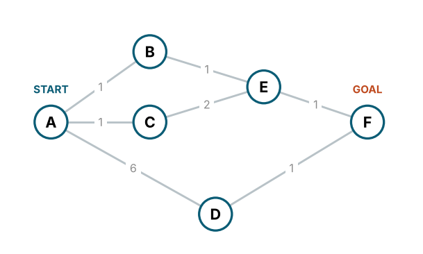
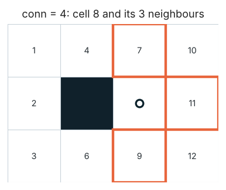

[← Course overview](README.md) · **01 The toolbox** · [02 DFS →](02_depth_first.md)

# 01 — Understand the toolbox before using it

**Block 1 · Guided MATLAB exercise**


> **Required activities:** Follow the steps marked **TASK** in order. Additional experiments are available for deeper investigation; they are not separate submissions. See [CORE_ROUTE.md](CORE_ROUTE.md).

## Your route through the files

**TASK — Required:** Open `experiments/01_toolbox_experiments.m`, work through its sections in order and use the matching `demos/demo_*.m` files to investigate the supplied functions. For every experiment, predict the outcome, run it, change one input and explain what you observed.

**Do not begin by implementing a search algorithm.** Today you will investigate the tools that make the algorithms possible.

1. **TASK:** In MATLAB, run `setup_path` and `check_tools`. The second command checks the **provided infrastructure**, not your future algorithms.
2. **TASK:** Open `experiments/01_toolbox_experiments.m`. This is **your editable experiment file**, with one MATLAB section (`%%`) per activity. Run one section at a time with **Run Section**. You may also type the short commands shown below directly in the Command Window.
3. **TASK:** For every activity, open the matching `demos/demo_*.m` in a **second Editor tab**. Read the inputs and the calls to helper functions; run the demo once, then change parameters in **your experiment file**, never in `tools/`.
4. **TASK:** Before each run, write a prediction. Afterwards, explain the observed result and what the behaviour contributes to a later planner.

| Activity | File to inspect and run | What you investigate | Used later in |
|---|---|---|---|
| 1 | `demos/demo_container.m` | LIFO, FIFO, `minkey`, duplicate entries | **All five searches**, especially Dijkstra |
| 2–3 | `demos/demo_graph.m` | Neighbours, costs, parent chain | **DFS, BFS and relaxation** |
| 4 | `demos/demo_grid.m` | Indices, legal neighbours, diagonal cost | **Random-map experiments** |
| 5 | `demos/demo_heuristic.m` | Effect of changing `h`, model assumptions | **Greedy and A*** |
| 6 | `demos/demo_maps.m`, `demos/demo_pattern.m` | Seeds, search loop, reachability | **All algorithms and final comparison** |

**How to reverse-engineer:** You do not need to read an entire helper function. First hypothesize how it behaves, choose an input that distinguishes plausible behaviours, run the experiment, and justify your conclusion. Use the collapsed solution only **after** your test.


## What you should be able to do

The search routines you will write are short because five helper groups take care of data structures, map access and visualization. Here you will **operate them yourself**. Knowing that a function exists is not the same as knowing what it returns.

At the end, you should be able to explain every call in this fragment:

```matlab
OPEN = open_new('fifo');
OPEN = open_push(OPEN, 3);
[OPEN, u] = open_pop(OPEN);
```

You should also be able to answer: *What is a node? What is a neighbour? What is stored in `par`? How does a grid cell receive its node number?*

## Activity 1 — OPEN is a decision rule

**TASK — Activity 1:** Open `demos/demo_container.m` and Section 1 of `experiments/01_toolbox_experiments.m`. Test `lifo`, `fifo` and `minkey` with the same nodes. Predict the extraction order, change the priorities and explain how OPEN determines the next node.

**Provided:** `open_new`, `open_push`, `open_pop`, `open_isempty`, `open_size`.

**Where and why:** Open `demos/demo_container.m` and find the three sections that call `open_new('lifo')`, `open_new('fifo')` and `open_new('minkey')`. Run `demo_container` once, noting the order in which each node leaves OPEN. Then switch to **Section 1** of `experiments/01_toolbox_experiments.m` and reproduce the behaviour with **your own input values**. This matters because the container, rather than the map, chooses the next node to investigate.

**TASK — Change one parameter:** Change **only** the OPEN mode. Keep the node sequence unchanged. Afterwards keep `'minkey'` fixed and change **only** the keys. Can the first node taken from OPEN change even though the insertion order stays the same?


**TASK — Predict on paper:** Insert nodes `4, 2, 7` in this order. What is the removal order for `'fifo'` and `'lifo'`? In `'minkey'`, give nodes `4, 2, 7` the priorities `3, 8, 1`: what is the removal order?

<details>
<summary>Show solution (after your own attempt)</summary>

**Expected result:**

| OPEN mode | Removal order | Reason |
|---|---|---|
| `'fifo'` | `4, 2, 7` | First in, first out |
| `'lifo'` | `7, 2, 4` | Last in, first out |
| `'minkey'` | `7, 4, 2` | Increasing priorities: `1, 3, 8` |

A priority is **not** the node number. Identical node IDs can also occur several times in `'minkey'`; the container does not perform a decrease-key operation. Functions such as `open_push` return an updated OPEN value, which must be assigned.

</details>


**TASK — Execute:** Use Section 1 in `experiments/01_toolbox_experiments.m`; the equivalent minimal code is shown here for reference:

```matlab
OPEN = open_new('fifo');
for v = [4 2 7]
    OPEN = open_push(OPEN, v);
end

out = [];
while ~open_isempty(OPEN)
    [OPEN, u] = open_pop(OPEN);
    out(end+1) = u;
end
out
```

1. **TASK:** Verify your predictions for FIFO and LIFO by changing the mode.
2. **TASK:** For priority-based search, use `open_push(OPEN, node, priority)` and verify the result.
3. **TASK:** Insert a repeated node using `'minkey'` with a different priority. Observe that the container does not automatically remove duplicates.
4. **TASK:** Intentionally omit `OPEN =` before one `open_push` call. Does the result change? Why?

**Checkpoint:** Explain the difference between *insertion order*, *priority*, and *duplicate entries*. Later, those will determine which search algorithm you have implemented.

**TASK — Reverse-engineer:** Does inserting node `5` with key 10 and later node `5` with key 2 *replace* the older entry or create two entries? Design a call sequence using `open_size`, `open_pop` and its optional key output that distinguishes both hypotheses.

<details>
<summary>Show solution (after your own attempt)</summary>

Both entries remain in this supplied container. After the two pushes, `open_size(OPEN)` is 2; the lower-key entry leaves first. This is why cost-based planners need a mechanism to ignore **stale** entries once a node has been finalized. The container itself does not implement relaxation.

</details>


## Activity 2 — Ask a graph about its neighbours

**TASK — Activity 2:** Open `demos/demo_graph.m` and Section 2 of your experiment file. Query the neighbours of A and another node with `graph_neighbors`. Compare the node IDs and edge weights with the plotted graph.

The lecture models a planning problem as a weighted graph \(G=(V,E,w)\). For this lab, the given six-node graph has nodes A–F, numbered 1–6. A–D is an expensive shortcut.



**Where and why:** Open `demos/demo_graph.m`, locate the loop that calls `graph_neighbors(G.W,u)`, and run `demo_graph`. Then work in **Section 2** of your experiment file. The algorithm will ask this function on **every expansion**: `nb(k)` is the possible next node; `w(k)` is the price for reaching it.

**Investigate, do not just read the output:** Compare `[nb,w]` with row `G.W(1,:)` and explain what a zero matrix entry means. Predict the output for E (node 5) before changing the queried node.


**TASK — Predict:** Which nodes are adjacent to A? Which has the most expensive connection from A?

<details>
<summary>Show solution (after your own attempt)</summary>

A (node 1) has neighbours **B, C and D** (nodes `2, 3, 4`), with edge weights `1, 1, 6`. The most expensive direct connection is **A–D (cost 6)**.

For E (node 5), the neighbours are B, C and F with weights `1, 2, 1`. Changing A–D from 6 to 2 changes only the weight of that connection, not its existence. `nb(k)` identifies a neighbour and `w(k)` gives the cost of that **same** edge.

</details>


```matlab
G = graph_example();
[nb, w] = graph_neighbors(G.W, G.s)
plot_graph(G, 'Title', 'The course graph');
```

1. **TASK:** For node E (index 5), query and record all neighbours and edge costs.
2. **TASK:** Change the graph *in a temporary copy*: `W2 = G.W; W2(1,4) = 2; W2(4,1) = 2;`.
3. **TASK:** Re-run the neighbour query. Which results change, and which do not?
4. **TASK:** Explain why `graph_neighbors` returns **two** vectors of equal length.

**Checkpoint:** If `nb(k)` names the neighbour, what does `w(k)` mean?

**TASK — Reverse-engineer:** Change only `W2(1,4)`, leaving `W2(4,1)` unchanged, and query both directions. What does this show about an *undirected* graph and the graph representation? Restore symmetry afterwards.

<details>
<summary>Show solution (after your own attempt)</summary>

The matrix stores **two directions separately**. If only `W2(1,4)` changes, querying A includes the new cost to D but querying D still reports the old cost to A. Our course assumes undirected edges, so updating both symmetric entries is required to preserve the intended model.

</details>


## Activity 3 — Reconstruct a route

**TASK — Activity 3:** In `demos/demo_graph.m` and Section 3 of the experiment file, inspect a `par` array. Predict the path, use `reconstruct_path`, then change a predecessor and explain how the result changes.

A search does not store the entire path for every partial route. It records each node's **predecessor**, `par(v)`.

**Where and why:** Stay in `demos/demo_graph.m` and find the `par` vector and the call to `reconstruct_path`. Run the demo and read the `par` entries **backwards from the goal**, rather than copying the displayed path. Then use **Section 3** of your experiment file to construct your own predecessor chain.

**TASK — Change one parameter:** Modify the predecessor chain while keeping the graph unchanged. Does the *search algorithm* run again? Or can the final path be assembled using only predecessor information? Explain why search algorithms store `par(v)` during expansion.


**TASK — Predict:** If F came from E, E from B, and B from A, what path will be reconstructed?

<details>
<summary>Show solution (after your own attempt)</summary>

The predecessor chain is `F ← E ← B ← A`. Reversing it gives **A–B–E–F**, i.e. `p = [1 2 5 6]`, with cost `1 + 1 + 1 = 3`.

If F's predecessor becomes D and D's predecessor becomes A, the path is **A–D–F** with cost `6 + 1 = 7`. An unreachable goal yields no path and infinite cost; when start equals goal, the path contains that one node and has zero cost.

</details>


```matlab
par = zeros(6,1);
par(2) = 1;
par(5) = 2;
par(6) = 5;
[p, c] = reconstruct_path(par, 1, 6, G.W)
```

1. **TASK:** Check your prediction and the total cost against the graph.
2. **TASK:** Change the parent of F to D and that of D to A. Do not change anything else. What happens to the path and cost?
3. **TASK:** Test an unreachable goal using a fresh `zeros(6,1)` predecessor array.
4. **TASK:** Explain the difference between `p = []` and a valid path with zero edges (`s == t`).

**Checkpoint:** What information must your algorithm update when it discovers a node?

## Activity 4 — From cells to node numbers

**TASK — Activity 4:** Open `demos/demo_grid.m` and Section 4 of the experiment file. Convert between `(row,column)` and linear indices, query 4- and 8-neighbours, and test why a diagonal through blocked corners must be rejected.

In the occupancy grid, `0` means free space and `1` means an obstacle. MATLAB uses **column-major linear indexing**.

**Where and why:** Open and run `demos/demo_grid.m`, then use **Section 4** of your experiment file. Watch how `(row,column)` becomes one node index, then inspect the returned legal neighbours. This transformation is essential because the search functions use **scalar node IDs**, not coordinate pairs.

**Parameter experiment:** Keep the same `M` and current cell `u`; change only `conn` from 4 to 8. Compare **both** the neighbour indices and their edge costs. Then toggle corner cutting on a map where the decision matters.


```matlab
M = [0 0 0 0;
     0 1 0 0;
     0 0 0 0];

u = sub2ind(size(M), 2, 3);
[r, c] = ind2sub(size(M), u);
[nb4, w4] = grid_neighbors(M, u, 4);
[nb8, w8] = grid_neighbors(M, u, 8);
```

**Before execution:** Predict `u`, `(r,c)`, and the legal 4-neighbours. Then run it.

<details>
<summary>Show solution (after your own attempt)</summary>

MATLAB stores matrix entries **column by column**. For a 3-by-4 grid, `(row 2, column 3)` has index `u = 2 + (3-1)·3 = 8`; converting it back gives `(r,c) = (2,3)`.

Legal 4-neighbours: `(1,3)`, `(3,3)` and `(2,4)`, with linear indices **7, 9, 11** and cost 1 each. `(2,2)` is occupied. With 8-neighbourhood and corner cutting forbidden, `(1,4)` and `(3,4)` are additionally reachable, at cost `sqrt(2)` each. Diagonal moves toward `(1,2)` and `(3,2)` are blocked by the obstacle at `(2,2)`.

</details>


1. **TASK:** Convert every entry of `nb4` back to `(row,column)` and verify it on the matrix.
2. **TASK:** Compare `nb4` with `nb8`; which additional moves become legal?
3. **TASK:** Compare costs for horizontal, vertical and diagonal movement.
4. **TASK:** Construct a small map in which moving diagonally would pass between two obstacles. Compare `grid_neighbors(M,u,8,false)` with `grid_neighbors(M,u,8,true)`.



**Checkpoint:** Why is a legal diagonal move generally more expensive than a horizontal step? Why is corner cutting a physical problem rather than a plotting error?

## Activity 5 — A heuristic is an estimate

**TASK — Activity 5:** Open `demos/demo_heuristic.m` and Section 5 of the experiment file. Compare heuristic values for selected cells, change the heuristic type and explain the difference between a geometric estimate and an actual obstacle-aware path cost.

A heuristic `h(v)` estimates the remaining cost from node `v` to the goal. It does **not** inspect obstacles.

**Where and why:** Open `demos/demo_heuristic.m` and run `demo_heuristic` before **Section 5** of your experiment file. Identify the line that *constructs* the function handle and the line that *evaluates* it at a particular node. We will use that same distinction in `greedy_graph.m` and `astar_graph.m`.

**Change one thing:** Keep start and goal fixed but switch `'manhattan'`, `'octile'`, `'euclid'` and `'zero'`. Then keep the heuristic fixed and change the goal. Decide which parameter affects the value and which environmental feature the function does *not* know about.


```matlab
R = 5; C = 6;
t = sub2ind([R C], 4, 5);
u = sub2ind([R C], 2, 2);

hm = grid_heuristic('manhattan', R, C, t);
he = grid_heuristic('euclid',    R, C, t);
ho = grid_heuristic('octile',   R, C, t);

[hm(u), he(u), ho(u)]
```

**Predict before running:** Which value will be largest? Which model of movement does each one assume?

<details>
<summary>Show solution (after your own attempt)</summary>

Here the row difference is `Δr = 2` and the column difference is `Δc = 3`.

| Heuristic | Value at `u` | Assumption |
|---|---:|---|
| Manhattan | `2 + 3 = 5` | Horizontal/vertical grid steps only |
| Octile | `1 + 2·sqrt(2) ≈ 3.828` | Diagonals cost `sqrt(2)` |
| Euclidean | `sqrt(13) ≈ 3.606` | Straight-line distance |

Thus **Manhattan is largest**, then Octile, then Euclidean. Since these estimates depend on relative coordinates rather than obstacles, adding a wall does not change them. A zero heuristic gives no information about the goal.

</details>


1. **TASK:** Change only the goal index and repeat.
2. **TASK:** Use `'zero'` as the heuristic and describe what information it provides.
3. **TASK:** Draw an obstacle between `u` and `t` without changing either endpoint. Explain why the heuristic value stays the same.

**Checkpoint:** For unit-cost 4-neighbour moves, which heuristic matches the unobstructed grid distance? For 8-neighbour moves with diagonal cost `sqrt(2)`, which one is appropriate?

## Activity 6 — Generate maps and recognize the loop

**TASK — Activity 6:** Run `demos/demo_maps.m`, Section 6 of the experiment file and `demos/demo_pattern.m`. Change a random seed, reproduce a map, then identify where the common search loop removes and expands nodes.

**Where and why:** First open `demos/demo_maps.m` and run `demo_maps`; then run **Section 6** of your experiment file with your own seeds. Finally open `demos/demo_pattern.m`, find its ten numbered operations and execute `demo_pattern` once. You should be able to say: **which line chooses the next node, which queries neighbours, which prevents repeated visits?** This will become the skeleton of DFS and BFS.

**Seed experiment:** Keep dimensions and obstacle density constant. Run the same seed twice and a different seed once. For fair algorithm comparisons, why must all planners see the **same** map? Does the perfect-maze generator have the same number of rows as its first input parameter? Check the reported `size`.


```matlab
[M1, s1, t1] = maze_obstacles(30, 40, 0.25, 7);
M2 = maze_random(10, 15, 42);

figure; plot_grid(M1, 'Start', s1, 'Goal', t1, 'Title', 'Obstacle field');
figure; plot_grid(M2, 'Title', 'Perfect maze');
```

1. **TASK:** Generate `M1` twice with the same seed: what remains identical?
2. **TASK:** Change the seed: what changes?
3. **TASK:** Explain why a perfect maze with 4-neighbour movement has only one path between two connected free cells, whereas an obstacle field may have alternatives.
4. **TASK:** Open and run `demo_pattern`, then identify where it **takes a node from OPEN** and where it **discovers neighbours**. Do not copy the loop into your search yet.

**Checkpoint:** What three changes turn the reachability loop in `demo_pattern` into a path search from start to goal?

**OPTIONAL TASK — Further investigation:** In `demo_pattern.m`, `seen` is updated **when a neighbour enters OPEN**, not when it comes out. Predict what might happen if you moved `seen(v)=true` to after removal instead, and optionally test the hypothesis by copying the short loop into a **separate scratch script**, not by altering the original demonstration.

<details>
<summary>Show solution (after your own attempt)</summary>

Without marking a node as soon as it is discovered, several already expanded neighbours can enqueue the **same still-unprocessed node**. The queue can grow unnecessarily and the expansion order can include duplicates unless additional checks are introduced. Marking on discovery is a simple way to prevent this in DFS/BFS. Dijkstra deliberately uses different rules because a cheaper route to a previously discovered node may appear.

</details>


<details>
<summary>Show solution (after your own attempt)</summary>

1. **Test for the goal** when a node is removed from OPEN, and terminate when it is found.
2. **Store the predecessor** of each newly discovered node (`par(v) = u`).
3. **Reconstruct the route** from the goal back to the start and compute its cost.

The underlying OPEN/expand/neighbours loop remains the same. A perfect maze generated by a DFS carving procedure forms a tree of passages: between two connected cells there is one simple route. Repeating the same random seed reproduces the same generated map.

</details>


## Before continuing

**TASK — Required:** Check that you can explain the return values of the helper functions without relying on the demos. If something is unclear, rerun the corresponding experiment; there is no separate written submission.

- [ ] I can operate all three OPEN modes without copying an example.
- [ ] I can query a graph and a grid for neighbours and costs.
- [ ] I can create a predecessor array and reconstruct a path.
- [ ] I can distinguish the actual path cost from a heuristic estimate.
- [ ] I know why repeatable random seeds matter in a comparison.

**Before leaving Chapter 01:** Use your completed `experiments/01_toolbox_experiments.m` and the six demo files to explain which functions you will call inside `tasks/dfs_graph.m`, and why. Keep your experiment file: you will reuse its OPEN experiments when debugging Dijkstra.

**Further investigation:** Inspect the function signatures in `tools/` without changing them. Which functions return a new data structure that must be reassigned, and which simply return an observation?

**Next:** [02 — Build DFS →](02_depth_first.md)
