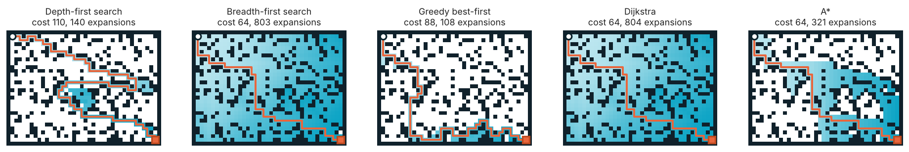

[← 07 Comparison](07_comparison.md) · **08 Car in the maze** · [09 CrazyCar outlook →](09_crazycar_outlook.md)

# 08 — A car travels through your maze

**Lab block 3 · Guided exercise · Edit `tasks/car_in_maze.m`**



## What is the goal?

Your **own path planner** must find a route through a random obstacle field. Then a simplified top-down **car symbol follows that route**. You will be able to show the route and explain which search algorithm produced it.

**Important distinction:** This task animates a car shape moving from grid cell to grid cell. It does *not* simulate steering angle, speed-dependent turning radius, tire forces or the CrazyCar simulator. Those belong to a subsequent vehicle-motion lab. The assignment here is to connect your own planner to an observable moving agent.

## Step 1 — Understand the provided animation (5–10 min)

**Open these files:** `demos/demo_car_visualization.m` and `tools/animate_car_grid.m`.

1. Find the occupancy grid `M`. What does a `1` mean?
2. Find the arrays `rr` and `cc`. How are they turned into a sequence of cell indices with `sub2ind`?
3. Run `demo_car_visualization`. Observe the orientation of the car shape at a turn.
4. Set `'StepPause'` to `0.02`. Does the route or reported path cost change? Why?

<details>
<summary>Show explanation (after your own attempt)</summary>

`StepPause` controls the display delay between successive cells. It does not enter any edge-cost calculation and does not represent physically simulated vehicle speed. The grid is still interpreted as free (`0`) or blocked (nonzero). The car's rectangular drawing rotates to face the next planned move, but this does not ensure such a turn is possible for a physical vehicle.

</details>

## Step 2 — Which code performs the actual planning? (10 min)

Open `tools/search_student_grid.m`. Locate the `switch` over the method name. It calls the **student's** `dfs_graph`, `bfs_graph`, `dijkstra_graph`, `greedy_graph` or `astar_graph`.

Run this in the MATLAB command window:

```matlab
[M, s, t] = maze_obstacles(18, 25, 0.20, 7);
[p, c, st] = search_student_grid(M, s, t, 'astar');
figure; plot_grid(M, 'Path', p, 'Expanded', st.order, 'Start', s, 'Goal', t);
```

**Explain:** Why must this call use `search_student_grid` rather than the already-completed reference function `search_grid`? What are the meanings of `p`, `c` and `st`?

## Step 3 — Connect planning and vehicle animation (15–25 min)

**Edit only:** `tasks/car_in_maze.m`.

The interface is already specified:

```matlab
[path, cost, stats] = car_in_maze(M, s, t, 'astar', true);
```

Derive the missing three actions:

1. **Planning:** Call `search_student_grid` with the map, endpoints and algorithm name. Store all three returned values.
2. **Safety:** Before drawing, check whether the returned path is empty. If it is empty, stop without calling the animation helper.
3. **Driving the display:** If `showAnimation` is true and the route is nonempty, call `animate_car_grid(M, path)`.

**Why this ordering?** Drawing cannot find a route. A route may not exist. A successful planner and a valid nonempty path must be established before displaying the vehicle.

<details>
<summary>Show a possible implementation (after your own attempt)</summary>

```matlab
[path, cost, stats] = search_student_grid(M, s, t, method);
if isempty(path)
    fprintf('No route found.\n');
    return
end
if showAnimation
    animate_car_grid(M, path);
end
```

</details>

## Step 4 — Check and vary one parameter (10–15 min)

```matlab
check_my_code('astar')
check_car_maze
run('experiments/08_car_experiment.m')
```

Try a second maze seed, then switch the method from `'astar'` to `'bfs'`. Keep the map and endpoints unchanged while comparing the two planners.

**Can you explain why A* often explores fewer cells although both routes have the same cost on a 4-neighbour unit-cost grid?** Why does neither solution yet guarantee that a real CrazyCar can follow the path?

<details>
<summary>Show explanation (after your own attempt)</summary>

A* uses `g+h` to prioritize candidate nodes, while BFS explores in increasing numbers of steps. On the specified 4-neighbour grid, both can find minimum-cost paths, but their expansion patterns may differ. The car graphic simply interpolates between grid cells; neither turning curvature nor a valid steering command is considered.

</details>

## Result to keep

Your completed `tasks/car_in_maze.m` produces a visually verifiable animation using your planner. You should also be able to explain the separation between **route computation** and **route execution**.

No screenshot collection, separate experiment report or additional paper worksheet is required by these instructions. Your instructor specifies the final assessment criteria.

---

[← 07 Comparison](07_comparison.md) · [09 Vehicle-aware planning outlook →](09_crazycar_outlook.md)
