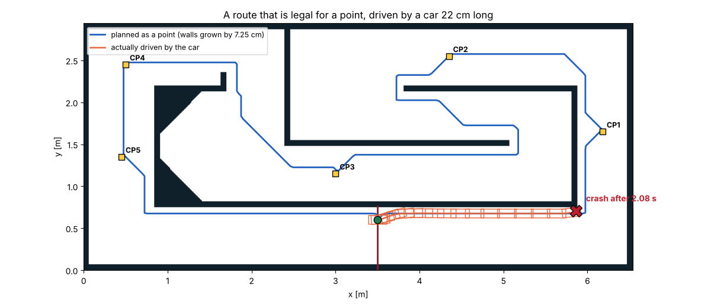
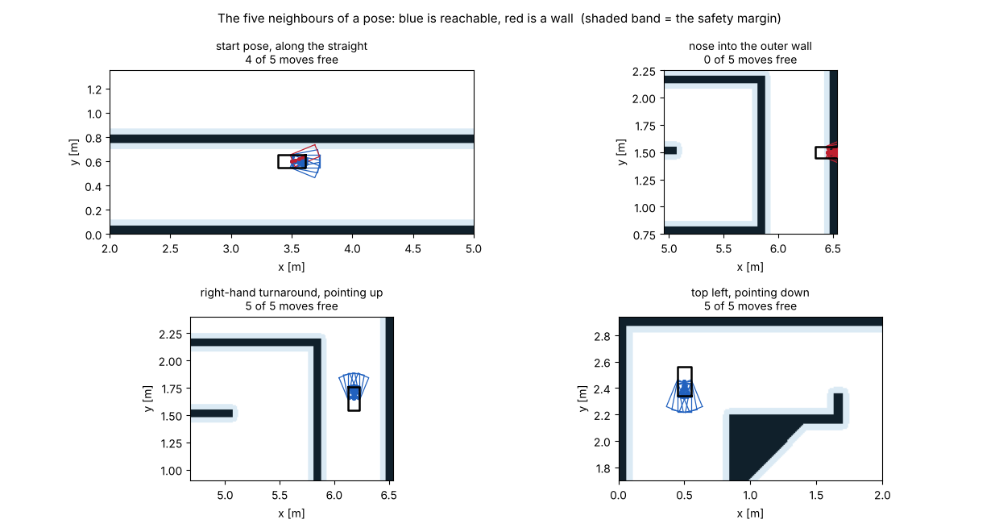

[← 07 Comparison](07_comparison.md) · **08 The vehicle in the search** · [09 Practice circuit →](09_practice_circuit.md)

# 08 — Put the vehicle into the neighbour search

**Block 4 · Guided MATLAB exercise**


> **Required activities:** Follow the steps marked **TASK** in order. Additional experiments are available for deeper investigation; they are not separate submissions. See [CORE_ROUTE.md](CORE_ROUTE.md).

## Goal

Your five algorithms plan for a **point**. A point may sit in any free cell and step to any of its four or eight neighbours. A car may not: it is 22 by 10.5 centimetres, it cannot move sideways, and it cannot turn on the spot.

None of your five algorithms has to change. What changes is the one function all five of them call to ask *where can I go from here* — `graph_neighbors`. In this chapter you replace it with `car_neighbors`.

To write that function you first have to answer a question the maze never asked: **which places can this vehicle actually reach from where it stands?** That set is the car's **motion space**, and you compute it from the vehicle model.

Two files, in this order:

| file | what it answers |
|---|---|
| `tasks/car_primitives.m` | What are the five moves the car has, as pure geometry? |
| `tasks/car_neighbors.m` | Where do those moves lead from a given pose, and does the car fit there? |

### File tour — one function, three new obligations

**TASK — Required:** Open `tasks/car_neighbors.m` beside `tools/graph_neighbors.m`. Both answer the same question for the same searches. List the three things the new one must do that the old one did not.

The three are:

- **A node is no longer a cell.** It is a **pose** `(x, y, theta)` — where the car is *and* which way it points. The same position with a different heading is a different node.
- **The moves are arcs, not steps.** They come from the vehicle, not from the grid.
- **The test is a rectangle, not a cell.** "Is that cell free" becomes "does a 22 × 10.5 cm box fit there, at that angle, all along the way".

Everything else — OPEN, `g`, `par`, the closed check, `reconstruct_path` — stays exactly as you wrote it in chapters 02 to 06.


## Step 1 — The car, in six numbers

**TASK — Step 1:** Run the vehicle demo and write down the six numbers below. Then predict, before reading on, which of them affect *finding* a route and which only affect *driving* it.

```matlab
demo_cc_vehicle
```

| from `cc_params` | value | what it is |
|---|---|---|
| `P.L` | 0.12 m | wheelbase, front axle to rear axle |
| `P.lr` | 0.06 m | rear axle to the reference point (the middle of the body) |
| `P.bodyL` × `P.bodyW` | 0.22 × 0.105 m | the rectangle that must not touch a wall |
| `P.deltaMax` | 22° | how far the front wheels turn |
| `P.ayMax` | 7.85 m/s² | how much grip the tyres have |
| dead band | 27.75 % | below this throttle the motor produces nothing |

<details>
<summary>Show solution (after your own attempt)</summary>

**Geometry decides the route:** `P.L`, `P.lr` and `P.deltaMax` fix which arcs exist at all. `P.bodyL` and `P.bodyW` decide whether an arc fits between the walls.

**Grip and the dead band decide the drive:** they say how fast the car may take a given arc and whether the motor responds at all. Neither changes the *shape* of the route. That separation is what chapter 09 is built on.

The car is **twice as long as it is wide**. Keep that in mind: it is the reason a route that is legal for a point can still put a corner of the car into a wall.

</details>


## Step 2 — Why the point planner is not merely conservative

**TASK — Step 2:** Plan a lap with your own A\* as if the car were a point, then drive it.

```matlab
run('experiments/experiment_cc_point_vs_model.m')
```



The planner was not careless. `tools/cc_track.m` already grows every wall by `P.inflate = 7.25 cm`, which is half the car's width plus two centimetres of margin. That is the standard trick — **configuration space**: rather than teach five algorithms about the car's shape, add the shape to the walls once.

It works for the width. It does not work for the length.

**TASK — Calculate on paper:** The car is `bodyL = 0.22 m` long and `bodyW = 0.105 m` wide, and its position is the middle of the body. If the body sits at an angle `psi` to the direction it is travelling, its outer front corner reaches

```
d(psi) = (bodyL/2) * sin(psi) + (bodyW/2) * cos(psi)
```

Work out `d(0°)`, `d(15°)` and `d(30°)`, and compare each with the 7.25 cm the walls were grown by.

<details>
<summary>Show solution (after your own attempt)</summary>

| `psi` | `d(psi)` | walls grown by | fits? |
|---|---|---|---|
| 0° | 5.25 cm | 7.25 cm | yes |
| 15° | 7.92 cm | 7.25 cm | **no** |
| 30° | 10.05 cm | 7.25 cm | **no** |

A single fixed margin can only be right for one angle. Inflation assumes the obstacle grows by a constant amount in every direction, which is true for a disc and false for a rectangle twice as long as it is wide. The maximum is `sqrt((bodyL/2)^2+(bodyW/2)^2)=12.2` cm, at `psi = 64.5°` — and inflating by 12.2 cm closes the narrow corridors of the track entirely, so there would be no route at all.

The way out is not a bigger margin. It is to stop pretending the car is a point.

</details>


## Step 3 — From a steering command to a rotation

**TASK — Step 3:** Follow the chain from what you command to how the car turns. It has four links, and you will write the last two yourself.

### 3a — Per cent to a wheel angle

You do not command an angle. You command a **percentage**, −100 to +100, exactly as the original simulator does. `tools/cc_step.m` converts it in one line, taken unchanged from `+car/percToCar.m`:

```matlab
deltaDes = (P.deltaMax / 100) * percSteer;    % 100 % = 22 deg, so 1 % = 0.22 deg
```

So the percentage is the **angle of the front wheels**, not a slip angle at the tyre. This model has no tyre slip: the wheels roll exactly where they point.

### 3b — The servo does not get there at once

`P.steerRate` is 110 deg/s, and one step is 1/25 s, so the steering moves at most **4.4 degrees per step**. Going from full left to full right takes 0.40 s, which is ten steps.

**TASK — Predict:** A probe of one motion primitive lasts about thirteen steps. If you start it with the steering at zero and immediately command full lock, how much of that probe is the servo still moving? What would it do to the arc you measure?

<details>
<summary>Show solution (after your own attempt)</summary>

Full lock is 22 deg, so the servo needs 22/110 = 0.20 s, which is **five of the thirteen steps** — nearly 40 % of the probe. During those five steps the car is turning less than it should, so the measured arc comes out too straight: 21.29 deg instead of 22.50 at full lock.

That is why `tools/cc_primitives_probe.m` starts the state with `.delta` already at the target. It is not cheating; it is measuring the steady arc rather than the servo.

</details>

### 3c — The wheel angle to a rotation

The car is modelled as a **bicycle**: the two front wheels become one steered wheel, the two rear wheels one fixed wheel. The state is `(x, y, theta)`, the steering angle is `delta`, and the speed is `v`.

Because the reference point is the middle of the body and not the rear axle, the car does **not** travel in the direction it points. It travels at a **side slip angle** `beta` to it:

```
beta = atan( (lr/L) * tan(delta) )
```

With that, the model per **second** is

```
xDot     = v * cos(theta + beta)
yDot     = v * sin(theta + beta)
thetaDot = (v/L) * cos(beta) * tan(delta)
```

**TASK — Calculate on paper:** Divide `thetaDot` by `v` to get the turning per **metre driven** instead of per second. Then put in full lock, `delta = 22°`, and compute the radius of the tightest circle the car can drive.

<details>
<summary>Show solution (after your own attempt)</summary>

```
dtheta/ds = thetaDot / v = cos(beta) * tan(delta) / L
```

**The speed cancelled.** This is the single most important line in the chapter: the *shape* of an arc does not depend on how fast it is driven. So the search can work in metres and leave the speed entirely to chapter 09.

With `delta = 22°`: `tan(delta) = 0.4040`, `beta = atan(0.5 * 0.4040) = 11.42°`, `cos(beta) = 0.9802`, so

```
dtheta/ds = 0.9802 * 0.4040 / 0.12 = 3.30 rad/m
R         = 1 / 3.30             = 0.303 m
```

A turning circle of 30 cm radius, on a track whose narrowest corridor is 59 cm wide.

</details>

### 3d — The whole chain, in numbers

| command | `delta` | `beta` | `dtheta/ds` | radius | turn per 0.119 m arc |
|---:|---:|---:|---:|---:|---:|
| 10 % | 2.20° | 1.10° | 0.320 rad/m | 3.124 m | 2.18° |
| 25 % | 5.50° | 2.76° | 0.801 rad/m | 1.248 m | 5.46° |
| 50 % | 11.00° | 5.55° | 1.612 rad/m | 0.620 m | 10.99° |
| 75 % | 16.50° | 8.42° | 2.442 rad/m | 0.410 m | 16.65° |
| 100 % | 22.00° | 11.42° | 3.300 rad/m | 0.303 m | 22.50° |

**TASK — Calculate on paper:** Reproduce the 50 % row from the three formulas above. Then answer two questions about the table as a whole.

1. Ten per cent gives 0.320 rad/m and a hundred per cent gives 3.300. Ten times the command gives 10.3 times the curvature. Why is it so nearly linear, when `tan(delta)` is not?
2. There are **two** rotations in this model. Name both, and say which one the search stores in a pose.

<details>
<summary>Show solution (after your own attempt)</summary>

**The 50 % row.** `delta = 0.5 * 22° = 11°`, `tan(11°) = 0.1944`,
`beta = atan(0.5 * 0.1944) = 5.55°`, `cos(beta) = 0.99531`, so
`dtheta/ds = 0.99531 * 0.1944 / 0.12 = 1.612` rad/m and `R = 0.620` m.
Over one arc: `1.612 * 0.119 = 0.1918` rad = 10.99°.

**1. Why nearly linear.** Up to 22° the tangent grows a little *faster* than its angle, while `cos(beta)` shrinks a little as `beta` grows. The two effects pull in opposite directions and very nearly cancel: the error over the whole range is 3 %. In the lab you may say "twice the command, twice the curvature". The search may not — it computes the exact value, which is the whole of `car_primitives`.

**2. The two rotations.**

- **The heading `theta`** turns at `thetaDot`. At full lock and 1 m/s that is 3.30 rad/s, or 189 deg/s.
- **The direction of travel** is `theta + beta`, not `theta`. The body sits at an angle to its own path — up to 11.42° at full lock.

The search stores `theta`, the heading, because that is what the next primitive is rotated by. But the *position* advances along `theta + beta`. That is why the integration in `car_primitives` reads

```matlab
x = x + ds * cos(thMid + beta);
```

and not `cos(thMid)`. Leave `beta` out of those two lines and the arc ends 23 mm away from where the car really goes — `check_car_primitives` will tell you so by name.

</details>

### 3e — And the grip caps it

None of this holds if the tyres cannot deliver it. Cornering needs `ay = |v * thetaDot| <= P.ayMax` = 7.85 m/s². At full lock that limits the car to `sqrt(7.85/3.30) = 1.54` m/s; above it `cc_step` scales the yaw rate down and the car runs wide.

That is a limit on the **speed**, not on the shape of the arc — which is exactly why it belongs to chapter 09 and not here.


## Step 4 — Choose how far one move goes

**TASK — Step 4:** Explain why `P.arc` is 0.119 m and not a round number. The two parameters you need are `P.nTheta = 16` and the turning rate you just computed.

The search cannot store a heading to infinite precision — it needs a finite number of nodes, so `P.nTheta = 16` headings are kept, 22.5° apart. One move must therefore land the car **exactly** on a stored heading.

**TASK — Predict:** What goes wrong if the arc length is set to a round 0.15 m instead?

<details>
<summary>Show solution (after your own attempt)</summary>

Full lock turns 3.30 rad per metre. One heading step is `2pi/16 = 0.3927` rad. So the arc that turns exactly one step is

```
s=(0.3927)/(3.30)=0.119 m
```

At 0.15 m, full lock turns 0.495 rad — one and a quarter heading steps. The search has to round that to a stored heading, so the pose it records is not the pose the car would be in. Do that a hundred times along a lap and the stored route and the real one drift apart. The route then looks valid to the planner and is not driveable.

Choosing the discretisation to fit the vehicle, rather than rounding the vehicle to fit the discretisation, is the whole idea.

</details>


## Step 5 — Write the motion space

**TASK — Step 5:** Complete the three TODOs in `tasks/car_primitives.m`, then check with `check_car_primitives`.

`P.steerLevels = [-1, -0.5, 0, 0.5, 1]` — five steering angles, so five moves: −22°, −11°, 0°, +11°, +22°. Each one is an arc of `P.arc` metres, computed **in the car's own frame**: start at the origin pointing along +x.

The three TODOs are the three lines you derived in step 3:

- **TODO 1** the side slip angle `beta`
- **TODO 2** the turning per metre `dtheta/ds`
- **TODO 3** walking the arc in `nSub = 4` equal steps

TODO 1 and TODO 2 are the two formulas you derived in step 3c — one line each. TODO 3 is the one you turn into code yourself; the loop and the bookkeeping are already in the file, with a marked slot for each of the four missing statements (`TODO 3a` to `3d`). The rule is three sentences:

- Walk the arc in `nSub` equal steps of `ds = P.arc/nSub`.
- Over each step the heading advances by `dthdS*ds`, and the car moves `ds` in the direction it is **travelling** — which is `theta + beta`, not `theta`.
- For the position step, use the heading **in the middle** of the step, not at its start or its end.

**TASK — Explain:** Why the middle? Work out what the other two choices do to the arc before you look.

Store all `nSub` intermediate poses in `pts`. `car_neighbors` tests every one of them against the walls, not just the end of the arc.

### See it before you check it

```matlab
demo_my_motion_space                       % the oval, from its start pose
demo_my_motion_space([], 'Track','crazycar')
```

This draws **your** five arcs, with the area the body sweeps behind each one. A fan that leans, an arc that bends too late, a primitive that went the wrong way — all three are obvious in the picture and invisible in a table of numbers. It works before `car_neighbors.m` exists; every move is then drawn as allowed.

### How this is checked

`check_car_primitives` does **not** compare your answer with a copy of the answer. It compares it with `cc_primitives_probe`, which arrives at the same five arcs from the other direction: it holds the steering angle and drives `cc_step` until the car has covered `P.arc` metres. Your formula and the simulator know nothing about each other.

```
       steering  dx [m]       dy [m]       dtheta       arc / chord
  ok      -22.0    +0.10914    -0.04559    -22.502 deg   0.1190 / 0.1183
  ok      -11.0    +0.11663    -0.02277    -10.993 deg   0.1190 / 0.1188
  ok       +0.0    +0.11900    +0.00000     +0.000 deg   0.1190 / 0.1190
  ok      +11.0    +0.11663    +0.02277    +10.993 deg   0.1190 / 0.1188
  ok      +22.0    +0.10914    +0.04559    +22.502 deg   0.1190 / 0.1183

  ok   left and right mirror each other
  ok   full lock turns exactly one heading step (22.50 of 22.50 deg)
```

Your formula and the simulator agree to **0.10 mm**. They share no code: one integrates the model in distance, the other drives the car at 25 Hz and interpolates. Agreement to a tenth of a millimetre is not a coincidence, and disagreement would be a real finding.

<details>
<summary>Show solution (after your own attempt) — the midpoint</summary>

Over one step the heading sweeps from `th` to `th + dthdS*ds`. Using the heading at the start makes the car move as if it had not yet begun to turn, so every arc bends too late and ends too far out. Using the heading at the end bends too early and ends too far in. The midpoint splits the difference, and the two errors cancel to first order.

It matters more than it sounds. With four steps the midpoint rule matches the simulator to **0.10 mm**; the start-of-step rule misses the end of a full-lock arc by **5.8 mm**. Note that the heading comes out right either way — only the position is wrong — so this is a mistake the end-of-arc heading will never reveal. Nearly six millimetres per move, over the hundred and sixty moves of a lap, is not a rounding error.

For comparison, leaving `beta` at zero misses by **23 mm** and also turns the car 22.96° instead of 22.50°, so full lock no longer lands on a heading step at all.

**Optional experiment:** change `thMid` to `th` and run `check_car_primitives` again. Then change it back.

</details>


## Step 6 — Rebuild the neighbour function for the car

This is the step the whole chapter exists for. Your five searches ask one question in their inner loop, and until now a table answered it. Now the vehicle answers it.

```matlab
[nb, w] = graph_neighbors(W, u)        % chapters 01 to 07: ask a TABLE
[nb, w] = car_neighbors(CM, pose)      % from here on:      ask the CAR
```

Same outputs, same place in the loop. **Your A\* does not change by one line** — it never cared where the neighbours came from.

**TASK — Step 6:** Open `tasks/car_neighbors.m`. The skeleton is below: the loop over the five primitives is there, the bookkeeping is there, and every missing statement has a marked slot — `TODO 1a` to `1c`, `2a` to `2c`, `3`. Nine statements in all. Complete them, then check with `check_car_neighbors`.

```matlab
function [nb, w, poses] = car_neighbors(CM, pose)

x  = pose(1);  y = pose(2);  th = pose(3);
ct = cos(th);  sn = sin(th);

m = numel(CM.prim);
nb = zeros(1,m);  w = zeros(1,m);  poses = zeros(m,3);
kept = 0;

for k = 1:m
    pr = CM.prim(k);

    % ---- TODO 2: is the car clear all the way along the arc? ----
    ok = true;

    if ~ok
        continue
    end

    % ---- TODO 1: where does this primitive put the car? ----
    nx  = x;
    ny  = y;
    nth = th;

    % ---- TODO 3: the node number and the cost ----
    idx = cc_pose_index([nx ny nth], CM);
    if isempty(idx)
        continue
    end

    kept = kept + 1;
    nb(kept) = idx;  w(kept) = 0;  poses(kept,:) = [nx, ny, nth];
end

nb = nb(1:kept);  w = w(1:kept);  poses = poses(1:kept,:);
end
```

### TODO 1 — put the primitive where the car is

`car_primitives` gave you `pr.dx`, `pr.dy` and `pr.dth` **in the car's own frame**: as if the car sat at the origin pointing along +x. The car is somewhere else, pointing somewhere else, so every move has to be **turned by `th` first and moved to `(x, y)` second**. That is the plane rotation you already know:

```
x' = x cos(th) - y sin(th)
y' = x sin(th) + y cos(th)
```

applied to `(pr.dx, pr.dy)` and then offset by the car's position. The heading simply adds: `nth = th + pr.dth`. `ct` and `sn` are already computed for you at the top of the file — they do not change inside the loop.

### TODO 2 — test the whole arc, not just its end

A primitive is 11.9 cm of driving and the car is 22 cm long. `pr.pts` holds the same arc as four intermediate poses, each a row `[x y theta]` **in the car's own frame**.

So: move every row into the world with the same transform as TODO 1, hand it to `cc_pose_free`, and set `ok = false` as soon as one of them does not fit. There is no point testing the rest once one has failed.

Note that TODO 2 sits **before** TODO 1 in the file. That is deliberate: there is no point working out where a move ends if the car cannot get there — and it means the transform you write in TODO 1 is the second time you write it, not the first. If that irritates you, you have understood something: pull it into a local function and call it twice.

### TODO 3 — the cost

`cc_pose_index` is given; it turns a pose into the node number your `closed` set needs, or `[]` if the move left the track. The cost is `pr.cost` — the arc length plus a small surcharge for steering, so that between two routes of the same length the search prefers the one that weaves less.

**TASK — Predict:** Before you run anything, answer two questions.

1. What happens if you translate first and rotate afterwards?
2. What happens if you test only the final pose of each arc?

<details>
<summary>Show solution (after your own attempt)</summary>

**1. Translate then rotate** rotates the car's *position about the origin of the track* instead of rotating the arc about the car. The neighbours scatter across the map. It is the most common error in this exercise, and it is loud: the search finds nothing, or finds something absurd.

The quieter version of the same mistake is forgetting to rotate `dy` at all — writing `nx = x + pr.dx*ct` and `ny = y + pr.dy`. That hides beautifully, because at the start pose `th` is 0, `sn` is 0, and everything looks right. It only breaks once the car turns, and then the route comes apart in the corners — which is where you were about to blame the controller.

**2. Testing only the end pose** accepts an arc whose middle goes through a wall. On a 0.119 m arc with a 0.22 m car that happens near every corner: both endpoints clear, the swept rectangle in between not. Case [6] of `check_car_neighbors` is built from exactly that.

</details>

### What you should see

```
  [1] ok     on the bottom straight, pointing along it    5 of 5 moves free
  [2] ok     same place, pointing the other way           5 of 5 moves free
  [3] ok     right-hand corner, pointing up               5 of 5 moves free
  [4] ok     left-hand corner, pointing down              5 of 5 moves free
  [5] ok     top straight, going left                     5 of 5 moves free
  [6] ok     the arc clips the inner wall                 0 of 5 moves free
  [7] ok     only some of the moves are left              4 of 5 moves free
  [8] ok     across the lane -- the car does not fit here 0 of 5 moves free
```

Case **[1] passes even when the rotation is wrong**, which is why it is first: with the car pointing along +x, `sin(th)` is zero and the mistake hides. Case [6] catches testing only the end of the arc. Cases [7] and [8] are the two that could not exist in a grid search at all — one position, two headings, two different answers.



Run `demo_my_motion_space` again now. A move your `car_neighbors` rejected is drawn in red, so you can see whether it really was blocked — **rejecting a free move is as wrong as accepting a blocked one**, and it is the quieter of the two mistakes: the search simply never finds the route that needed it, and reports that none exists.

```matlab
demo_my_motion_space([], 'Depth', 3)       % and three moves deep
```

If the whole fan comes out rotated or scattered across the map, that is TODO 1. Try it at the start pose *and* somewhere the car is turning — at the start pose `sin(th)` is zero and the mistake hides.

### Where it is used

Nothing else has to be rewired, because **the search already calls your file by name**. `cc_search_car` has

```matlab
if nargin < 5 || isempty(neighborFcn), neighborFcn = @car_neighbors; end
```

and `cc_lap_plan` defaults to the same. So the moment `car_neighbors.m` works, the whole chain runs on it:

```matlab
P  = cc_params('Track','oval');
T  = cc_track(P);
CM = cc_car_model(T, P);              % calls YOUR car_primitives
poses = cc_lap_plan(CM);              % which calls YOUR car_neighbors
```

If you also did the optional `tasks/astar_car.m`, the chain is yours end to end:

```matlab
poses = cc_lap_plan(CM, 'Planner', @astar_car);
```

## Checkpoint

**TASK — Required:** Confirm both checks pass and explain, without looking at your code, what a node is now and what a move is.

- [ ] I have looked at my own motion space in `demo_my_motion_space` and it is symmetric.
- [ ] `check_car_primitives` passes — my formula and the simulator agree.
- [ ] `check_car_neighbors` passes.
- [ ] I can write `dtheta/ds` from memory and say why the speed cancels.
- [ ] I can say why inflating the walls is not enough for a car twice as long as it is wide.
- [ ] I can say why the whole arc is tested and not just its end.

**Optional challenge:** Set `P.nTheta` to 8 and recompute the arc length that turns exactly one heading step. Does the search still find a route through the narrow channel? Explain the result in terms of what you have just built, then restore `P.nTheta = 16`.

**Next:** [09 — A lap on the practice track →](09_practice_circuit.md)
