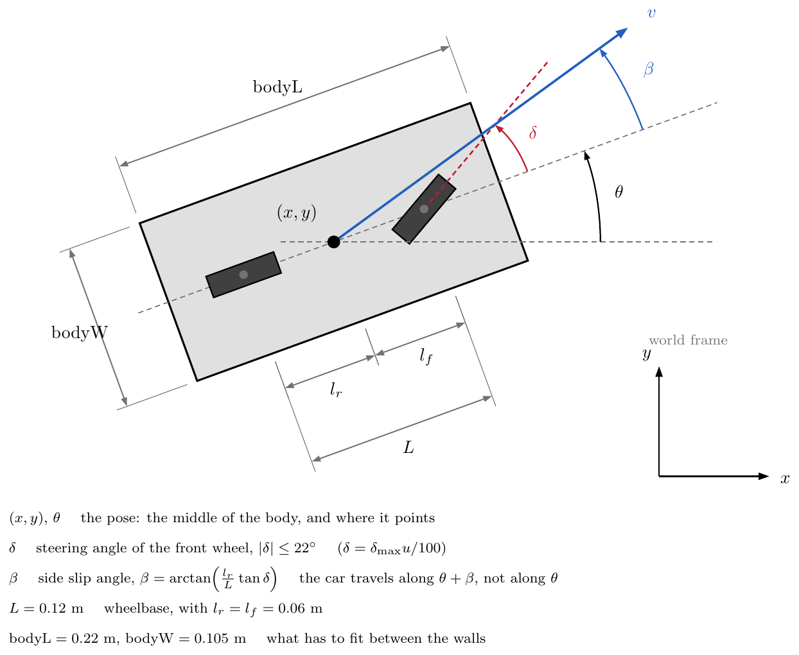
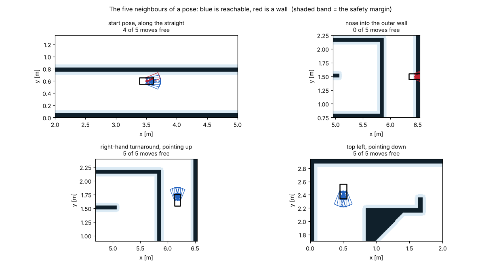

[THE GUIDED ROUTE](CORE_ROUTE.md) · [PREVIOUS: 07 Comparison](07_comparison.md) · [NEXT: 09 Practice circuit](09_practice_circuit.md)

# 08 — The vehicle, and the moves it can make

## Goal

Up to chapter 07 a node was a cell and a move was a step to the next cell. A
car cannot step sideways, and it is not a point: it is 22 cm long.

This chapter is one calculation and one function.

**The calculation:** the car stands somewhere, pointing somewhere, and drives a
short distance with the steering held at one value. **Where does it end up, and
which way is it pointing then?**

**The function:** `car_neighbors` — it asks that question five times, once per
steering setting, throws away the answers where the car would hit a wall, and
hands the rest to your A\* exactly as `graph_neighbors` did.

| you write | you are given |
|---|---|
| `tasks/car_primitives.m` — the five moves | the simulator, the controller, the search, the collision test |
| `tasks/car_neighbors.m` — the neighbour function | the track, the body test `cc_pose_free`, the node numbering `cc_pose_index` |

---

## Table of Contents

- [08 — The vehicle, and the moves it can make](#08--the-vehicle-and-the-moves-it-can-make)
  - [Step 1 — The vehicle](#step-1--the-vehicle)
  - [Step 2 — One move: the new position and the new orientation](#step-2--one-move-the-new-position-and-the-new-orientation)
  - [Step 3 — All the moves from one pose](#step-3--all-the-moves-from-one-pose)
  - [Step 4 — Which of the five can the car actually take?](#step-4--which-of-the-five-can-the-car-actually-take)
  - [Step 5 — Build the neighbour function](#step-5--build-the-neighbour-function)
  - [Checkpoint](#checkpoint)

---

## Step 1 — The vehicle



**TASK — Step 1:** Run the demo and write down the five numbers.

```matlab
demo_cc_vehicle
```

| from `cc_params` | value | what it is |
|---|---|---|
| `P.L` | 0.12 m | wheelbase, rear axle to front axle |
| `P.lr` | 0.06 m | rear axle to the reference point |
| `P.bodyL` × `P.bodyW` | 0.22 × 0.105 m | the rectangle that must not touch a wall |
| `P.deltaMax` | 22° | how far the front wheels turn |
| `P.arc` | 0.119 m | how far the car drives in one move |

Two things to notice, because everything else follows from them.

**The pose is $(x, y, \theta)$**, not $(x, y)$. The same spot with a different
heading is a different state, because a different set of moves leads out of it.

**The reference point $(x, y)$ is the middle of the body**, not the rear axle.
That is why a side slip angle $\beta$ appears in the next step: when the front
wheels are turned, the middle of the car does not travel in the direction the
car points.

You command **one number**: the steering, from −100 % to +100 %. The car accepts
any value in that range.

The planner does not get all of them. `P.steerLevels = [-1, -0.5, 0, 0.5, 1]` is
the set of options you **allow the search to choose from** — five out of a
continuum. That set is the search space, it is a decision, and in step 3 you
will change it and watch what happens.

---

## Step 2 — One move: the new position and the new orientation

This is the calculation the chapter is about.

> **Given** a pose $(x, y, \theta)$, a steering command $u$, and a distance $s$
> to drive.
> **Wanted** the pose at the end of that drive.

It is five steps, and only the last one has a loop.

| | step | from → to | at $u = 100\ \%$ |
|---|---|---|---|
| 1 | command to wheel angle | $u \rightarrow \delta = \delta_{\max} u / 100$ | $\delta = 22°$ |
| 2 | wheel angle to side slip | $\delta \rightarrow \beta = \arctan\!\left(\frac{l_r}{L}\tan\delta\right)$ | $\beta = 0.19933$ rad |
| 3 | wheel angle to a circle | $\delta, \beta \rightarrow R = \dfrac{L}{\cos\beta \tan\delta}$ | $R = 0.303$ m |
| 4 | walk the circle in `nSub = 4` pieces of $\Delta s = s/4$ | see below | $\Delta s = 0.02975$ m |
| 5 | store it | $\rightarrow$ `dx, dy, dth, pts` | 0.10914, 0.04559, 0.39273 rad |

**Step 3 is the whole idea.** Hold the steering still and the car drives a
circle; the steering angle decides nothing but its radius. In the code the
radius appears upside down, as `dthdS = 1/R`, because what the loop needs is
*turn per metre driven*:

$$
\frac{d\theta}{ds} \;=\; \frac{1}{R} \;=\; \frac{\cos\beta\,\tan\delta}{L}
$$

Note what is **not** in that formula: the speed. Drive the same arc fast or
slow and it has the same shape. That is why the search can plan in metres and
leave the speed to the simulator.

**Step 4, the loop.** Driving $\Delta s$ along a circle of radius $R$ turns the
car by $\Delta s / R$ — arc divided by radius, which is what a radian means.
That number is the same in every piece. At full lock it is 0.09818 rad = 5.63°.

Each piece is the same four statements:

```matlab
thMove = th + 0.5*dthdS*ds;        % the direction THIS PIECE goes
th     = th + dthdS*ds;            % the direction the CAR points afterwards
x      = x + ds*cos(thMove + beta);
y      = y + ds*sin(thMove + beta);
```

Two names, because they are two different things. `th` is where the **car
points** and is what gets stored. `thMove` is where the **straight piece goes**
— and a straight piece between two points of a circle points half the piece's
turn ahead of where the car points when it sets off. Work out `thMove` before
you overwrite `th`, or the value is gone.

And the car travels along $\theta + \beta$, not $\theta$: the heading says where
it points, $\beta$ is the angle between pointing and moving.

**TASK — Step 2:** Complete the three TODOs in `tasks/car_primitives.m`, then
run `check_car_primitives`.

The five steering levels, so you can check any of them:

| command | $\delta$ | $\beta$ | $1/R$ | $R$ | turn per piece | turn per move |
|---:|---:|---:|---:|---:|---:|---:|
| −100 % | −22.00° | −11.42° | −3.300 rad/m | 0.303 m | −5.63° | −22.50° |
| −50 % | −11.00° | −5.55° | −1.612 rad/m | 0.620 m | −2.75° | −10.99° |
| 0 % | 0° | 0° | 0 | — | 0° | 0° |
| +50 % | 11.00° | 5.55° | 1.612 rad/m | 0.620 m | 2.75° | 10.99° |
| +100 % | 22.00° | 11.42° | 3.300 rad/m | 0.303 m | 5.63° | 22.50° |

**If it does not come out, check one piece.** At full lock, after the **first**
pass of the loop:

```
beta   = 0.19933        dthdS = 3.3002        ds = 0.02975
thMove = 0.04909        th    = 0.09818
x      = 0.02884        y     = 0.00731
```

If `beta` and `dthdS` are right and the first pass is not, the fault is in the
loop. If `th` is right but `x` and `y` are not, the `+ beta` is missing.

The step-by-step version of this calculation — every statement, the full trace
of all four pieces, and what each mistake costs in millimetres — is in
[IMPLEMENTING_THE_ARC.md](IMPLEMENTING_THE_ARC.md).

---

## Step 3 — All the moves from one pose

Step 2 answered the question for **one** steering command. The search needs it
for **all** of them at once:

> I am standing at $(x, y, \theta)$. Where could I be after one move?

Five commands, five answers. Same three lines as in step 2, in a loop:

```matlab
P    = cc_params('Track','oval');
CM   = cc_car_model(cc_track(P), P);
pose = [1.60 0.50 0];                   % where I stand: x, y, theta

cand = zeros(numel(CM.prim), 3);
for k = 1:numel(CM.prim)
    pr = CM.prim(k);
    th = pose(3);
    cand(k,:) = [pose(1) + pr.dx*cos(th) - pr.dy*sin(th), ...
                 pose(2) + pr.dx*sin(th) + pr.dy*cos(th), ...
                 pose(3) + pr.dth];
end
disp(cand)
```

```
   command        x         y       theta
    -100 %     1.7091    0.4544    -0.3927
     -50 %     1.7166    0.4772    -0.1919
       0 %     1.7190    0.5000    +0.0000
     +50 %     1.7166    0.5228    +0.1919
    +100 %     1.7091    0.5456    +0.3927
```

Five candidate poses, spread 45° apart in heading and about 9 cm apart at their
ends. **That is the fan**, and the whole of this chapter is about producing it
and then deciding which of the five survive.

### The same five moves, at a pose that points elsewhere

Change only the pose — same `CM`, same five primitives:

```matlab
pose = [2.90 1.00 pi/2];                % same spot on the map, pointing up
```

```
   command        x         y       theta
    -100 %     2.9456    1.1091    +1.1781
     -50 %     2.9228    1.1166    +1.3789
       0 %     2.9000    1.1190    +1.5708
     +50 %     2.8772    1.1166    +1.7627
    +100 %     2.8544    1.1091    +1.9635
```

The fan now points **up** instead of right, because the moves were turned by the
car's heading before being added. Delete `cos(th)` and `sin(th)` from the three
lines and all five candidates come out pointing right again — the car would be
planning as if it always faced $+x$.

**TASK — Step 3:** Produce both tables. Then draw the fan:

```matlab
demo_my_motion_space('Track','oval')
```

### The set of commands is the search space, and it is yours

The car accepts any steering value; `cc_step` takes any percentage. The planner
does not get all of them:

> **`P.steerLevels` is the set of options you allow the search to choose from.
> Five is a decision, not a fact about the car.**

```matlab
P.steerLevels = [-1 0 1];                                  % three options
P.steerLevels = [-1 -0.75 -0.5 -0.25 0 0.25 0.5 0.75 1];   % nine, every 25 %
CM = cc_car_model(cc_track(P), P);                         % rebuild the moves
```

Planning the same oval lap with each of the three sets (chapter 09 shows how):

| the set you allow | expansions | moves tested | lap time | clearance |
|---|---:|---:|---:|---:|
| 3 options: −100, 0, +100 | 136 | 408 | 4.44 s | 38.2 mm |
| 5 options: the default | 185 | 925 | 4.40 s | 39.4 mm |
| 9 options: every 25 % | 176 | 1584 | 4.08 s | 37.2 mm |

**TASK — Explain:** The nine-option search expands **fewer** nodes than the
five-option one, and still does nearly twice the work. How can both be true?

<details>
<summary>Show solution (after your own attempt)</summary>

Every expansion asks for the fan exactly once, and building the fan tries
**every option in the set**:

```
moves tested = expansions × size of the set
```

136 × 3 = 408, 185 × 5 = 925, 176 × 9 = 1584. That column grows as you expect;
the expansion count does not have to. A finer set lets the planner steer gently
instead of alternating between hard lock and straight, so it finds a smoother
route — 4.08 s instead of 4.40 — and wanders less on the way there.

What a bigger set cannot do is give the car a new ability. Every option still
drives 0.119 m, still cannot stand still, and still cannot reverse.

</details>

---

## Step 4 — Which of the five can the car actually take?

The fan is produced from geometry alone — it knows nothing about walls. Now the
second question, the one you already know how to answer from step 1:

> Does the body fit there?

```matlab
free = cc_pose_free(CM, x, y, theta)      % the whole 22 × 10.5 cm rectangle
```

**And not only at the end of the move.** One move is 11.9 cm of driving with a
22 cm car, so both ends can be clear while the body sweeps through a wall in
between. That is what `pr.pts` is for: the four intermediate poses from step 2,
each one turned and shifted exactly like the end pose, each one tested.

**TASK — Step 4:** Take the fan at a pose near the outer wall of the oval and
test all five:

```matlab
pose = [2.60 0.50 0];                     % approaching the right-hand bend
```

```
   command        x         y       theta     end pose    whole arc
    -100 %     2.7091    0.4544    -0.3927      no           NO
     -50 %     2.7166    0.4772    -0.1919      no           NO
       0 %     2.7190    0.5000    +0.0000      no           NO
     +50 %     2.7166    0.5228    +0.1919      yes          yes
    +100 %     2.7091    0.5456    +0.3927      yes          yes
```

**Two of five survive.** The car is close to the outer wall and pointing along
it: going straight on or turning right puts the body into it, and only the two
left-hand turns lead anywhere.



Blue is a move the car may make, red one the body does not fit through. The
number of survivors changes from pose to pose: five in the open, two here, and
in a tight corner it can be none at all.

**TASK — Explain:** At this pose the end pose and the whole arc agree — a move
that fails at the end fails everywhere. Find a pose where they **disagree**:
the end is free but some point along the arc is not. Why is it easier to find
such a pose near a corner than along a straight?

---

## Step 5 — Build the neighbour function

Your searches ask one question in their inner loop. Until now a table answered
it; now the car does.

```matlab
[nb, w] = graph_neighbors(W, u)        % chapters 01 to 07: ask a TABLE
[nb, w] = car_neighbors(CM, pose)      % from here on:      ask the CAR
```

**Your A\* does not change by one line.** It never cared where the neighbours
came from.

### How to build it, in five sentences

The function answers one question: **standing here, where can the car be after
one move?** Take the five moves one at a time, and for each of them:

| | | with what |
|---|---|---|
| 1 | **Take the move.** It is written in the car's own frame, as if the car sat at the origin pointing along $+x$. | `pr = CM.prim(k)` |
| 2 | **Put it where the car is.** Turn it by `th`, then shift it to `(x, y)`. | `ct`, `sn`, computed at the top of the file |
| 3 | **Check the whole arc.** The same turn-and-shift for every row of `pr.pts`, and ask whether the body fits. One failure and this move is out. | `cc_pose_free` |
| 4 | **Give the end pose a node number.** The search works with numbers, not poses. | `cc_pose_index`, given |
| 5 | **Price the move.** | `pr.cost`, from step 2 |

Collect what survives and return the three lists.

### Turning and shifting

Step 2 above is the plane rotation you know, applied to `(pr.dx, pr.dy)` and
then offset by where the car is:

$$
\begin{pmatrix} x_{\mathrm{nb}} \\ y_{\mathrm{nb}} \end{pmatrix}
=
\begin{pmatrix} x \\ y \end{pmatrix}
+
\begin{pmatrix} \cos\theta & -\sin\theta \\ \sin\theta & \cos\theta \end{pmatrix}
\begin{pmatrix} \Delta x_k \\ \Delta y_k \end{pmatrix},
\qquad
\theta_{\mathrm{nb}} = \theta + \Delta\theta_k
$$

**Test it at a pose that is not pointing along $+x$**, or you will not notice
if the rotation is missing. The `+22 %` move, `dx = 0.10914`, `dy = 0.04559`:

| from | $\cos\theta$, $\sin\theta$ | correct | rotation forgotten |
|---|---|---|---|
| `[1.60 0.50 0]` | 1, 0 | (1.70914, 0.54559) | (1.70914, 0.54559) |
| `[2.90 1.00 pi/2]` | 0, 1 | **(2.85441, 1.10914)** | (3.00914, 1.04559) |

At the first pose both are identical — rotating by zero changes nothing. At the
second they are **17 cm apart, in different directions**.

**TASK — Step 5:** Complete `tasks/car_neighbors.m` — the loop and the
bookkeeping are in the file, every missing statement has a marked slot — and
run `check_car_neighbors`.


Blue is a move the car may make, red is one the body does not fit through. Note
that the number of neighbours changes from pose to pose: in the open it is five,
against a wall it can be one, and in a corner it can be none at all.

### See it before you check it

```matlab
demo_my_motion_space                      % your primitives, your neighbours
demo_my_motion_space('Track','oval','Depth',4)
```

---

## Checkpoint

**TASK — Required:** `check_car_primitives` and `check_car_neighbors` both pass,
and you can say without looking at your code:

1. what a node is now, and what a move is;
2. why the same position with two headings has two different sets of neighbours;
3. where the vehicle's size enters the search — and why it is not a margin
   around the walls.

Then: [09 — A lap on the practice circuit](09_practice_circuit.md).

Going further, all optional: [the four wheels the model replaces, the servo, the
grip limit, and why `P.arc` is 0.119 m](APPENDIX_going_further.md).
