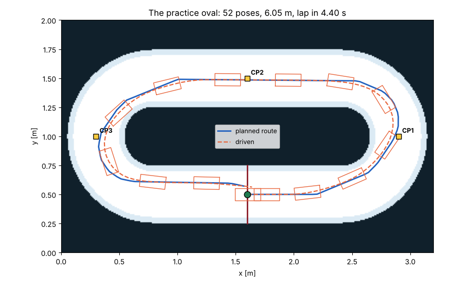

[THE GUIDED ROUTE](CORE_ROUTE.md) · [PREVIOUS: 08 The vehicle](08_vehicle_neighbors.md) · [NEXT: 10 The CrazyCar track](10_crazycar_track.md)

# 09 — A lap on the practice circuit

## Goal

Your neighbour function, on a real track: an oval, 3.2 × 2.0 m, with a start
pose and three checkpoints. Plan a lap, drive it, look at it.

Then the one knob that decides what the route looks like: **how far the planner
keeps the car away from the walls.**

Nothing new is written in this chapter. Everything runs on the two files you
wrote in chapter 08.

---

## Table of Contents

- [09 — A lap on the practice circuit](#09--a-lap-on-the-practice-circuit)
  - [Step 1 — Plan a lap](#step-1--plan-a-lap)
  - [Step 2 — Drive it](#step-2--drive-it)
  - [Step 3 — Inflation: how far from the wall?](#step-3--inflation-how-far-from-the-wall)
  - [Step 4 — Choose, and defend it](#step-4--choose-and-defend-it)
  - [Checkpoint](#checkpoint)

---

## Step 1 — Plan a lap

**TASK — Step 1:** Run the lap and read the leg table.

```matlab
run('experiments/experiment_oval_lap.m')
```

A lap is not one search. It is **four searches in a row**: start → CP1 → CP2 →
CP3 → start. Each leg begins at the pose the previous one ended in.

```
  leg 1 -> (2.90, 1.00):  13 poses, 1.48 m,    36 expansions
  leg 2 -> (1.60, 1.50):  14 poses, 1.66 m,    25 expansions
  leg 3 -> (0.30, 1.00):  14 poses, 1.60 m,    65 expansions
  leg 4 -> (1.60, 0.50):  14 poses, 1.67 m,    59 expansions
  LAP: 52 poses, 6.40 m, 185 expansions. Closes: yes
```

**TASK — Explain:** Why can a lap not be planned as a single search from the
start pose back to the start pose?

<details>
<summary>Show solution (after your own attempt)</summary>

Because your A\* stops the moment it reaches the goal — and it is standing on
the goal when it starts. It would return a route of length zero, which is
correct and useless.

The checkpoints are what force the lap to go the long way round. They are
places, not poses: the search stops when the car is within `P.cpTol` of one,
whichever way it happens to be pointing.

</details>

**TASK — Explain:** The four legs cost 6.40 m, but the route measures 6.05 m.
Where does the difference come from?

<details>
<summary>Show solution (after your own attempt)</summary>

From the cost you wrote in chapter 08:

```matlab
prim(k).cost = P.arc + P.wSteer * abs(steerLevel)
```

Steering carries a surcharge — about 2 cm of imaginary extra distance at full
lock. So between two routes of the same length the search prefers the one that
weaves less. 6.40 m is what the search **paid**; 6.05 m is what the car
**drives**.

</details>

---

## Step 2 — Drive it

The same experiment hands the route to the simulator and plots both.



Blue is what the search planned, red dashed is what the car actually drove, and
the rectangles are the car itself, every twentieth step.

```
  route length          6.05 m
  LAP TIME              4.40 s
  closest wall          39.4 mm
```

**TASK — Explain:** The planned route and the driven line are not the same
curve. Name two reasons, and say which of them the search could have known
about.

<details>
<summary>Show solution (after your own attempt)</summary>

**The controller follows, it does not teleport.** It steers towards a point
ahead of it on the route, so it cuts corners slightly on the inside.

**The speed is not in the plan.** The search works in metres and knows nothing
about how fast the car will take a bend; the simulator drives it at whatever
the speed profile allows, and at speed the car runs a little wide.

The search could have known about neither. Both are the price of planning the
*shape* of a route separately from the *driving* of it — and both are why the
next step exists.

</details>

---

## Step 3 — Inflation: how far from the wall?

`P.safety` is the margin the planner keeps between the car's rectangle and every
wall. The walls are **inflated** by it before the search starts: everything
within `P.safety` of a wall is treated as wall.

Raise it and the route is pushed towards the middle of the corridor. Lower it
and the planner is allowed to cut.

Two numbers judge the result, and they do not agree:

- the **lap time**, which you want small;
- the **clearance**, the smallest gap between the body and a real wall over the
  whole lap, which you want large. `cc_clearance` measures it.

"It did not crash" is not the second number. A lap that passed 11 mm from a wall
did not crash; it got away with it.

**TASK — Step 3 — predict first:** Write down what you expect the two numbers to
do as `P.safety` grows. Commit to a direction for each. Then measure:

```matlab
for saf = [0.00 0.02 0.05 0.08 0.10 0.12]
    P  = cc_params('Track', 'oval', 'safety', saf);
    T  = cc_track(P);
    CM = cc_car_model(T, P);
    try
        poses = cc_lap_plan(CM, 'Verbose', false);
    catch
        fprintf('safety %.2f : no route at all\n', saf);  continue
    end
    XY   = cc_resample_path(poses(:,1:2), 0.04);
    vRef = cc_speed_profile(XY, P);
    log  = cc_simulate(T, [XY, vRef]);
    fprintf('safety %.2f : %.2f s, clearance %4.1f mm\n', ...
            saf, log.lapTime, 1000*cc_clearance(T, log));
end
```

```
safety 0.00 : no route at all
safety 0.02 : 4.28 s, clearance 25.7 mm
safety 0.05 : 4.40 s, clearance 39.4 mm
safety 0.08 : 4.40 s, clearance 50.6 mm
safety 0.10 : 4.32 s, clearance 65.2 mm
safety 0.12 : 4.36 s, clearance 80.8 mm
```

**TASK — Explain:** Almost certainly your prediction was "more margin, safer and
slower". Row 0.10 is faster **and** roomier than row 0.05. How can a tighter
constraint produce a quicker lap?

<details>
<summary>Show solution (after your own attempt)</summary>

Because `P.safety` does not move one fixed route further from the walls. It
changes **which route the search finds at all**.

More margin squeezes the route towards the middle of the corridor, and the
middle of a bend is the line with the **largest radius**. A larger radius means
a higher speed before the tyres let go, $v \le \sqrt{a_{y,\max} R}$. The
constraint bought speed.

That is not a law — it is a property of a corridor wide enough that centring the
route makes it rounder. On the narrow track of chapter 10 the same knob behaves
quite differently.

</details>

---

## Step 4 — Choose, and defend it

**TASK — Step 4 — Required:** Pick the value of `P.safety` you would use on this
track, and write **three sentences**: what you optimised for, what you gave up,
and what measurement would make you change your mind.

There is no right answer here, and that is the point. Both numbers are real, and
they point in different directions.

---

## Checkpoint

**TASK — Required:** A lap that closes, a plot of it, and an answer to one
question: *why is a margin around the walls not the same thing as planning with
the car's shape?*

Then: [10 — The CrazyCar track](10_crazycar_track.md).

Optional: [what happens at zero margin, and why the lap fails there](APPENDIX_going_further.md#a5-the-lap-that-fails-at-zero-margin).
