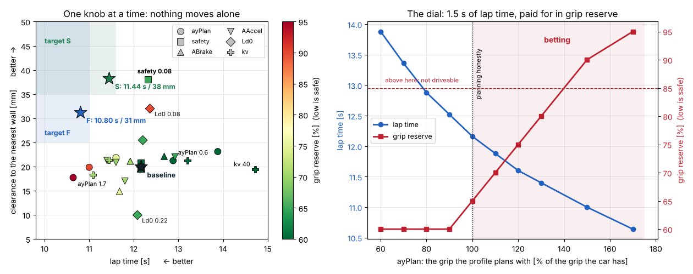

[← 09 Practice circuit](09_practice_circuit.md) · **10 The CrazyCar track**

# 10 — The CrazyCar track, and tuning it yourself

**Block 4 · Guided MATLAB exercise**


> **Required activities:** Follow the steps marked **TASK** in order. Additional experiments are available for deeper investigation; they are not separate submissions. See [CORE_ROUTE.md](CORE_ROUTE.md).

## Goal

The oval was built to be easy. This is the real track from the CrazyCar simulator: 6.54 by 2.94 metres, a serpentine rather than a ring, and its narrowest corridor is **0.59 m** for a car whose turning circle is 0.303 m.

Everything you have built goes on it unchanged. Then comes the last exercise of the lab, and it is the one with no right answer in it: **you tune it**, against three numbers that will not all improve at once.


### File tour — the eight numbers that are now yours

**TASK — Required:** Open `tools/cc_tuning_defaults.m` and read the eight values and what each one does. Open `experiments/experiment_cc_tuning.m` and find the one block you are meant to edit.

| | value | what it decides |
|---|---|---|
| `safety` | 0.05 m | how far the planner keeps the car from every wall |
| `ayPlan` | 1.00 | the fraction of the car's grip the speed profile plans with |
| `ABrake` | 2.5 m/s² | how hard the profile may slow down |
| `AAccel` | 2.0 m/s² | how hard it may speed up |
| `Ld0` | 0.16 m | lookahead when standing still |
| `kLd` | 0.08 s | extra lookahead per m/s |
| `LdMax` | 0.35 m | longest lookahead allowed |
| `kv` | 90 %/(m/s) | throttle per m/s of speed error |

What you may **not** change is the car: `P.ayMax`, `P.bodyL`, `P.bodyW`, `P.L`, `P.deltaMax`, `P.Vdead`. Tuning is choosing what to ask of a given vehicle. Changing the vehicle is a different exercise, and an easier one.


## Step 1 — A lap on the real thing

**TASK — Step 1:** Run the lap and compare the leg table with the oval's.

```matlab
run('experiments/experiment_cc_lap.m')
```

```
  leg 1 -> (6.18, 1.65):  30 poses,  3.53 m,   453 expansions
  leg 2 -> (4.35, 2.55):  21 poses,  2.46 m,    84 expansions
  leg 3 -> (3.00, 1.15):  46 poses,  5.69 m,  1955 expansions
  leg 4 -> (0.50, 2.45):  29 poses,  3.47 m,   935 expansions
  leg 5 -> (0.45, 1.35):  11 poses,  1.29 m,    46 expansions
  leg 6 -> (3.50, 0.60):  31 poses,  3.65 m,   184 expansions
  LAP: 163 poses, 20.10 m, 3657 expansions. Closes: yes

  LAP TIME              12.20 s
  top speed reached     2.02 m/s
  worst tracking error  60 mm
```

**TASK — Explain:** The oval cost 185 expansions over 6.05 m — about 31 per metre. This track costs 3657 over 19.23 m — about 190 per metre, six times as many, with identical code. Leg 3 alone accounts for more than half of it. Find CP2 at (4.35, 2.55) and CP3 at (3.00, 1.15) on the picture and draw the straight line between them.

<details>
<summary>Show solution (after your own attempt)</summary>

The straight line from CP2 to CP3 is 1.94 m long and runs **through the wall** that separates the top-right pocket from the middle channel. The car has to come down and round instead: 5.69 m.

`cc_car_heuristic` is straight-line distance. Compare what it estimated at the start of each leg with what that leg actually cost:

```
 leg   h(start)   true cost   ratio   expansions
  1       2.878       3.531    1.23       453
  2       2.029       2.460    1.21        84
  3       1.974       5.695    2.89      1955
  4       2.953       3.472    1.18       935
  5       1.150       1.290    1.12        46
  6       3.183       3.650    1.15       184
```

Five legs have a line of sight to their goal and the estimate is within 23 %. Leg 3 is out by a factor of **2.89**, and it is too low *everywhere in that region*. A\* takes the node with the smallest $g+h$; when $h$ is uniformly too low across an area, every node in it looks cheap, so the search spreads out over the area instead of crossing it. It degenerates towards Dijkstra exactly where it can least afford to.

The estimate is still **admissible** — it never overestimates — so the route A\* returns is still the cheapest it can find. Only the work is wasted. That is the distinction from chapter 06: admissibility buys you correctness, not speed.

**Optional:** flood the 5 cm planning grid outwards from each goal once with your own `dijkstra_graph` and use the result as a lookup table for $h$. It is still admissible, it knows about walls, and on leg 3 it would report about 5.5 m instead of 1.97.

</details>


## Step 2 — The margin window closes

On the oval, every margin from 0.02 to 0.12 m produced a lap. Here it does not.

**TASK — Step 2:** Run the same sweep as in chapter 09, with `cc_params()` instead of `cc_params('Track','oval')`.

| `P.safety` | result | clearance | expansions |
|---|---|---|---|
| 0.00 m | crash at (5.82, 0.68) after 1.64 s | | |
| 0.02 m | crash at (5.83, 0.68) after 1.64 s | | |
| 0.03 m | crash at (5.90, 0.71) after 1.68 s | | |
| 0.04 m | crash at (1.65, 2.44) after 8.24 s | | |
| 0.05 m | 12.20 s | 19.2 mm | 3657 |
| 0.06 m | 12.16 s | 17.0 mm | 3577 |
| 0.07 m | 12.12 s | 21.8 mm | 3295 |
| 0.08 m | 12.32 s | **38.3 mm** | 3138 |
| 0.10 m | **no route exists** — `leg 1 failed` | | |

**TASK — Explain:** Two things to account for. First, between 0.03 and 0.04 the lap still fails but the crash **moves to the other end of the track**, from (5.90, 0.71) to (1.65, 2.44). Second, the usable window is only 0.05 to 0.08 m wide, and above it there is no route at all. Give the number that closes the window.

<details>
<summary>Show solution (after your own attempt)</summary>

**The moving crash.** The margin was never fixing *the* problem; it was fixing *the worst current one*. At 0.03 the tightest spot is the right-hand turnaround. Raise the margin and that spot becomes survivable, which reveals the next-tightest somewhere else entirely. 0.05 is simply the value at which the worst remaining spot happens to be survivable.

So 0.05 m is a **measurement of this track**, not a property of the car. On another track the cliff is somewhere else, and you would find it the same way: by crashing.

**The ceiling.** The narrowest corridor is 0.59 m — measure it yourself as the smallest free run along any row of `T.Mfine`. A margin of $s$ on both sides leaves $0.59 - 2s$, and the car needs more than its 0.105 m width: skewed by $\psi$ against that corridor wall, its body reaches out to

$$
d(\psi) \;=\; \frac{\mathrm{bodyL}}{2}\,\sin\psi \;+\; \frac{\mathrm{bodyW}}{2}\,\cos\psi
$$

up to 0.122 m at $\psi = 64.5^\circ$. At $s = 0.10$ the grown walls close the right-hand turnaround of leg 1 and there is no pose sequence left. Not a bug — an honest answer to an impossible question.

Compare with the oval, where 0.12 m was still comfortable. Same code, same car; the track decides.

</details>


## Step 3 — Why two numbers are not enough

Chapter 09 judged a lap by its time and its clearance. On this track that is not sufficient, and here is the case that shows it.

**TASK — Step 3:** Run the tuning bench on the defaults, then again with `cfg.ayPlan = 1.7`.

```matlab
run('experiments/experiment_cc_tuning.m')
```

```
  LAP TIME         12.20 s        <- make this small
  CLEARANCE           19 mm       <- room in SPACE, keep it large
  GRIP RESERVE        65 %        <- room in GRIP, keep it low
```

| | lap time | clearance | grip reserve |
|---|---|---|---|
| defaults | 12.20 s | 19.2 mm | 65 % |
| `ayPlan = 1.7` | **10.68 s** | 18.1 mm | **95 %** |

By lap time it is 1.5 s better. By clearance it is barely worse, and it never touches a wall. By the third number it is a setup you would not put on a car.

**The grip reserve** is measured by driving the same route with the same controller and the tyres made progressively weaker — 95 %, 90 %, 85 % of `P.ayMax` — and reporting the lowest value that still gets round. **Low is good.** The defaults survive a third of their grip going missing. `ayPlan = 1.7` fails as soon as the car is 10 % worse than its model, and a real car always is a few per cent worse than its model.

**TASK — Explain:** Say what `ayPlan = 1.7` actually asks the car to do, in terms of the line in `cc_speed_profile` that uses it. Then say what physically happens at the moment it fails.

<details>
<summary>Show solution (after your own attempt)</summary>

```matlab
vRef(turning) = min(o.VMax, sqrt(o.AyMax ./ kappa(turning)));
```

With `AyMax` set to 1.7·`P.ayMax` the profile permits corner speeds $\sqrt{1.7} = 1.30$ times higher than the tyres can hold. It is not planning a faster lap; it is planning a lap **for a car with 70 % more grip than this one**. The simulator reports it spending 30 of 306 steps at the grip limit, against 2 for the defaults.

When the grip drops, the car cannot generate the lateral acceleration its own plan demands, so it does not follow the arc. It **understeers**: it keeps going straighter than the steering asked for, drifts to the outside of the bend, and the outside of a bend is a wall.

Clearance could not have told you this, because on the lap it actually drove it did not come close to a wall. Two numbers measure two different kinds of room, and this setup had run out of the one that was not being measured.

</details>


## Step 4 — One value at a time

**TASK — Step 4:** Before measuring, commit on paper to a **sign** for each of the eight values: does raising it make each of the three numbers better, worse, or neither? Twenty-four cells. Then measure.

```matlab
base = cc_tuning_defaults();
for v = [0.08 0.12 0.16 0.22 0.30]
    cfg = base;  cfg.Ld0 = v;
    S = cc_scorecard(cfg);
    fprintf('Ld0 %.2f -> %5.2f s | reserve %3.0f %% | %4.1f mm | %d slipping\n', ...
        v, S.lap, 100*S.reserve, 1000*S.clear, sum(S.log.slipping));
end
```



**`ayPlan` — the grip the profile plans with**

| | lap | reserve | clearance |
|---|---|---|---|
| 0.60 | 13.92 s | 60 % | 22.3 mm |
| 0.80 | 12.92 s | 60 % | 19.6 mm |
| 1.00 | 12.20 s | 65 % | 19.2 mm |
| 1.20 | 11.64 s | 75 % | 20.8 mm |
| 1.50 | 11.04 s | 90 % | 18.8 mm |
| 1.70 | 10.68 s | 95 % | 18.1 mm |

**`Ld0` and `kLd` — the lookahead**

| | lap | reserve | clearance | at the grip limit |
|---|---|---|---|---|
| `Ld0` 0.08 | 12.52 s | **90 %** | **29.7 mm** | 7 steps |
| `Ld0` 0.12 | 12.24 s | 65 % | 25.6 mm | 4 |
| `Ld0` 0.16 | 12.20 s | 65 % | 19.2 mm | 2 |
| `Ld0` 0.22 | 12.12 s | 70 % | **11.0 mm** | 1 |
| `kLd` 0.00 | crash at (4.21, 2.79) after 4.08 s | | | |
| `kLd` 0.18 | 12.12 s | 70 % | 11.0 mm | 1 |

**`LdMax` — the cap on the lookahead**

| | lap | reserve | clearance |
|---|---|---|---|
| 0.22 m | 12.32 s | 65 % | 27.4 mm |
| 0.28 m | 12.20 s | 65 % | 18.9 mm |
| 0.35 m | 12.20 s | 65 % | 19.2 mm |
| 0.50 m | 12.20 s | 65 % | 19.2 mm |
| 0.70 m | 12.20 s | 65 % | 19.2 mm |

**`ABrake`, `AAccel`, `kv` — asking for more of the car**

| | lap | reserve | clearance |
|---|---|---|---|
| `ABrake` 1.5 | 12.76 s | 60 % | 22.0 mm |
| `ABrake` 5.0 | 11.72 s | 75 % | 15.8 mm |
| `AAccel` 1.0 | 12.92 s | 65 % | 21.9 mm |
| `AAccel` 6.0 | 11.44 s | 70 % | 15.4 mm |
| `kv` 40 | 14.80 s | 60 % | 18.9 mm |
| `kv` 140 | 11.48 s | 70 % | 21.9 mm |
| `kv` 200 | 11.12 s | 70 % | 17.0 mm |


## Step 5 — Two results worth stopping at

**TASK — Step 5a:** `LdMax` makes no difference at all above 0.28 m: three rows identical to the millimetre. Explain it in one line, with a number in the line.

<details>
<summary>Show solution (after your own attempt)</summary>

The lookahead is $L_d = L_{d0} + k_{Ld}\,v$, capped at `LdMax`. The fastest the car goes on this lap is 2.02 m/s, so the largest value the formula ever produces is

$$
0.16 + 0.08 \cdot 2.02 = 0.32\ \text{m}
$$

which never reaches the 0.35 m cap. Raise the cap and nothing changes, because nothing was touching it. Lower it to 0.22 and it starts binding on the straights, which is why that is the only row that moves.

A knob that does nothing is not harmless. It is a knob you will reach for when something goes wrong, and it will cost you an hour.

</details>

**TASK — Step 5b:** In the `Ld0` block the two safety numbers **disagree**: the short lookahead has more room in space (29.7 mm) and far less in grip (90 %), and the long lookahead is the other way round. Explain both directions. The last column is the evidence.

<details>
<summary>Show solution (after your own attempt)</summary>

**Short lookahead: much space, no grip reserve.** The steering law is $\delta = \arctan\!\left(\frac{2L\sin\alpha}{L_d}\right)$. $L_d$ is in the denominator, so for the *same* deviation from the line a shorter lookahead commands a **larger steering angle**. The car tracks the planned line tightly — and that line is where the planner put it, 50 mm from the walls — but it does so by cornering harder than the lap requires: seven steps at the grip limit instead of one. Take 15 % of the grip away and it can no longer produce the lateral acceleration its own corrections demand, and it runs wide.

**Long lookahead: no space, grip to spare.** The car aims past the bend, so it leaves the planned line towards the inside: it **cuts the corner**. Cutting is why it is quicker, and the 8 mm it gained came straight out of the planner's margin. But a cut corner has a *larger* radius than the planned one, so it asks the tyres for less — one step at the limit instead of seven.

The two numbers measure two different failure modes:

- **clearance** — how much of the planner's margin the controller gave back;
- **reserve** — how close the lap is to the limit of the tyres.

Which is why neither alone will do, and why no single score replaces them. Bound the reserve first — treat anything above about 85 % as not driveable — and spend what is left on time.

</details>


## Step 6 — Hit a target

**TASK — Step 6:** Choose **one** of these and tune for it. Both must also get round the practice oval with the same values, because a setup that only works on the track it was tuned on is a fitted curve, not a controller.

**Target S — the lap you would put on real hardware**

```
clearance  >= 35 mm
reserve    <= 70 %
lap time   <  11.60 s
```

**Target F — the fast lap, with a floor under it**

```
lap time   <= 11.00 s
clearance  >= 25 mm
reserve    <= 70 %
```

Each has room to spare, so there is more than one answer. Neither is reachable by turning a single knob: every setting that gets close on one number fails another.

**Before you start sweeping, one practical thing.** Every `cc_scorecard` call runs the lap once and then up to eight more times to find the grip reserve. While you are hunting for a lap time you do not need the reserve:

```matlab
S = cc_scorecard(cfg, 'Reserve', false);     % about eight times faster
```

Sweep with that, and only measure the reserve on the two or three settings you are actually considering. The same goes for the oval check — leave it to the end.

One hint, because it is the hint that teaches something: **one of the eight values buys a great deal of clearance for almost no time**, and makes the search cheaper as well. Step 2 is about it. Set that one first, then spend what it gave you on the other seven, which all charge for what they give.

### What to hand in

**TASK — Required:** Four things.

1. Your eight values, and the three numbers they produce on **both** tracks.
2. One line per value you changed: *what you bought and what you paid*. Not "I raised kv to 140" but "kv 90 → 140 bought 0.72 s and cost 5 points of reserve, because the car now chases its target speed harder and spends more steps near the grip limit".
3. The values you did **not** change, and why not. `LdMax` belongs on that list, with the reason from step 5a.
4. One sentence on which target you chose and for what kind of use. "For a demo in front of the class" and "for a car that has to survive twenty laps unattended" are different answers, and both are correct.


## Checkpoint

**TASK — Required:** Confirm a lap that closes, and explain the three numbers without looking at the code.

- [ ] `experiment_cc_lap.m` gives a lap that closes on the real track.
- [ ] I can explain why leg 3 costs more than half of the search.
- [ ] I can explain why the margin window is 0.05 to 0.08 m here and much wider on the oval.
- [ ] I filled in the 24-cell prediction table **before** measuring.
- [ ] I can explain `LdMax`, and the `Ld0` contradiction.
- [ ] I met one target on both tracks and wrote down what I bought and paid.

**Optional challenge:** `P.ayMax = 7.85 m/s²` is the only number in the whole model that was assumed rather than taken from the original simulator. Work out which of your conclusions would change if it were 20 % lower, and which would not — then set it and find out whether you were right.

[← 09 Practice circuit](09_practice_circuit.md) · **10 The CrazyCar track**
