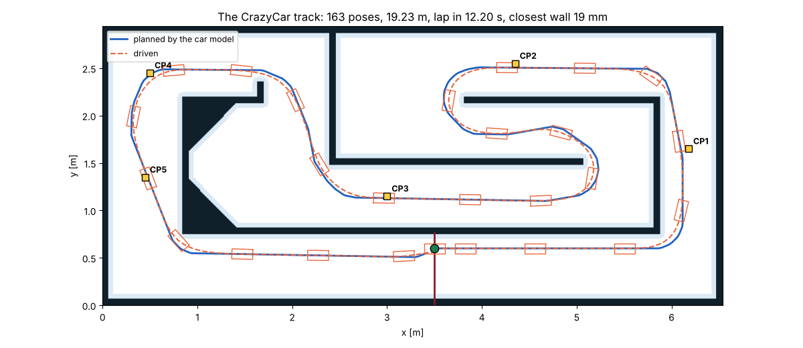

[THE GUIDED ROUTE](CORE_ROUTE.md) · [PREVIOUS: 09 Practice circuit](09_practice_circuit.md)

# 10 — The CrazyCar track

## Goal

The same code, on the real thing: 6.5 × 2.9 m, six checkpoints, and corridors
that are 59 cm wide in places — for a car that is 22 cm long and swings its
corners out when it turns.

Three questions, in this order:

1. does your planner get round it?
2. what would it cost to plan as if the car were a point?
3. how much margin can you afford?

Nothing new is written here either.

---

## Table of Contents

- [10 — The CrazyCar track](#10--the-crazycar-track)
  - [Step 1 — A lap on the real track](#step-1--a-lap-on-the-real-track)
  - [Step 2 — What planning for a point would cost](#step-2--what-planning-for-a-point-would-cost)
  - [Step 3 — The margin window](#step-3--the-margin-window)
  - [What to hand in](#what-to-hand-in)

---

## Step 1 — A lap on the real track

**TASK — Step 1:** Run it and compare the leg table with the oval's.

```matlab
run('experiments/experiment_cc_lap.m')
```

```
  leg 1 -> (6.18, 1.65):  30 poses,  3.53 m,   453 expansions
  leg 2 -> (4.35, 2.55):  21 poses,  2.46 m,    84 expansions
  leg 3 -> (3.00, 1.15):  46 poses,  5.69 m,  1955 expansions
  leg 4 -> (0.50, 2.45):  29 poses,  3.47 m,   935 expansions
  leg 5 -> (0.45, 1.35):  11 poses,  1.29 m,    46 expansions
  leg 6 -> (3.50, 0.60):  31 poses,  3.65 m,   184 expansions
  LAP: 163 poses, 20.10 m, 3657 expansions. Closes: yes

  LAP TIME              12.20 s
  top speed reached     2.02 m/s
```



**TASK — Explain:** The oval cost 185 expansions over 6.05 m, about 31 per
metre. This track costs 3657 over 19.23 m, about 190 per metre — six times as
many, with identical code. Leg 3 alone is more than half of it. Find CP2 at
(4.35, 2.55) and CP3 at (3.00, 1.15) in the picture and draw the straight line
between them.

<details>
<summary>Show solution (after your own attempt)</summary>

The straight line between those two checkpoints goes **through the block in the
middle of the track**. The heuristic measures that straight line and reports
about 1.97 m; the car actually has to drive 5.69 m around the obstacle.

A\* expands nodes in order of `g + h`. When `h` is far too small over a whole
region, every node in that region looks cheap, so the search spreads out across
it instead of crossing it. It degenerates towards Dijkstra exactly where it can
least afford to.

The fix is not a better search. It is a better `h` — one that knows about walls.

</details>

---

## Step 2 — What planning for a point would cost

The walls of this track are already grown by `P.inflate = 7.25 cm`, half the
car's width plus a margin. That is the classic trick: instead of teaching five
algorithms about the car's shape, add the shape to the walls once.

It works for the width. It does not work for the length.

**TASK — Step 2:** Plan the lap with your grid A\* from chapter 06, as if the
car were a point, and hand that route to the same car.

```matlab
run('experiments/experiment_cc_point_vs_model.m')
```


The point route is shorter, and for a point it is collision-free. The car
**crashes after 2.08 s**.

**TASK — Calculate on paper:** The body is 0.22 × 0.105 m and its position is
the middle. When the body sits at an angle $\psi$ to the wall it is passing, its
corner reaches

$$
d(\psi) \;=\; \frac{\mathrm{bodyL}}{2}\sin\psi \;+\; \frac{\mathrm{bodyW}}{2}\cos\psi
$$

Work out $d(0°)$, $d(15°)$ and $d(30°)$ and compare each with 7.25 cm.

<details>
<summary>Show solution (after your own attempt)</summary>

| $\psi$ | $d(\psi)$ | walls grown by | fits? |
|---|---|---|---|
| 0°, parallel to the wall | 5.25 cm | 7.25 cm | yes |
| 15° | 7.92 cm | 7.25 cm | **no** |
| 30° | 10.05 cm | 7.25 cm | **no** |

At $\psi = 0$ the car reaches out exactly half its width, which is what
`P.inflate` was built from. Every other angle reaches further, because the
length starts to count. The worst case is 12.2 cm at $\psi = 64.5°$ — and
inflating by 12.2 cm closes the narrow corridors completely, so there would be
no route at all.

The way out is not a bigger margin. It is to stop pretending the car is a point
— which is what `car_neighbors` does.

</details>

---

## Step 3 — The margin window

On the oval every margin from 0.02 to 0.12 m produced a lap. Here it does not.

**TASK — Step 3:** Run the sweep from chapter 09 again, with `cc_params()`
instead of `cc_params('Track','oval')`.

| `P.safety` | result | clearance |
|---|---|---|
| 0.03 m | crash at (5.90, 0.71) after 1.68 s | |
| 0.04 m | crash at (1.65, 2.44) after 8.24 s | |
| 0.05 m | 12.20 s | 19.2 mm |
| 0.06 m | 12.16 s | 17.0 mm |
| 0.07 m | 12.12 s | 21.8 mm |
| 0.08 m | 12.32 s | **38.3 mm** |
| 0.10 m | **no route at all** — leg 1 fails | |

**TASK — Explain:** The usable window is 0.05 to 0.08 m and nothing else. Give
the number that closes it at the top.

<details>
<summary>Show solution (after your own attempt)</summary>

The narrowest corridor is **0.59 m**. A margin of $s$ on both sides leaves
$0.59 - 2s$, and the car needs more than its 0.105 m width, because turning, its
corners reach out to $d(\psi)$ from step 2 — up to 0.122 m.

With $s = 0.10$: $0.59 - 0.20 = 0.39$ m of free corridor. That is still wider
than the car, but not wide enough for the car **plus the swing it needs to
change direction** inside it. Leg 1 has no route.

Below 0.05 the margin stops protecting anything, and the crash simply moves to
whichever corner the route cut most tightly.

</details>

---

## What to hand in

**TASK — Required:** Three things.

1. A **plot** of your lap on the CrazyCar track, with the value of `P.safety`
   you used.
2. The three numbers it produced: lap time, clearance, expansions.
3. **Three sentences**: why a route that is legal for a point is not legal for
   this car; why a bigger margin is not the answer; and what your choice of
   margin optimised for.

---

## Checkpoint

**TASK — Required:** A lap that closes on this track with the same code that
closed the oval, and an answer to the question the whole block was built around:

*What changed between chapter 07 and chapter 10 — in the search, and in what
the search is searching through?*

Optional, and only if you want more: [tuning the controller itself — eight
values, three numbers that disagree](APPENDIX_going_further.md#a6-tuning-the-controller).
