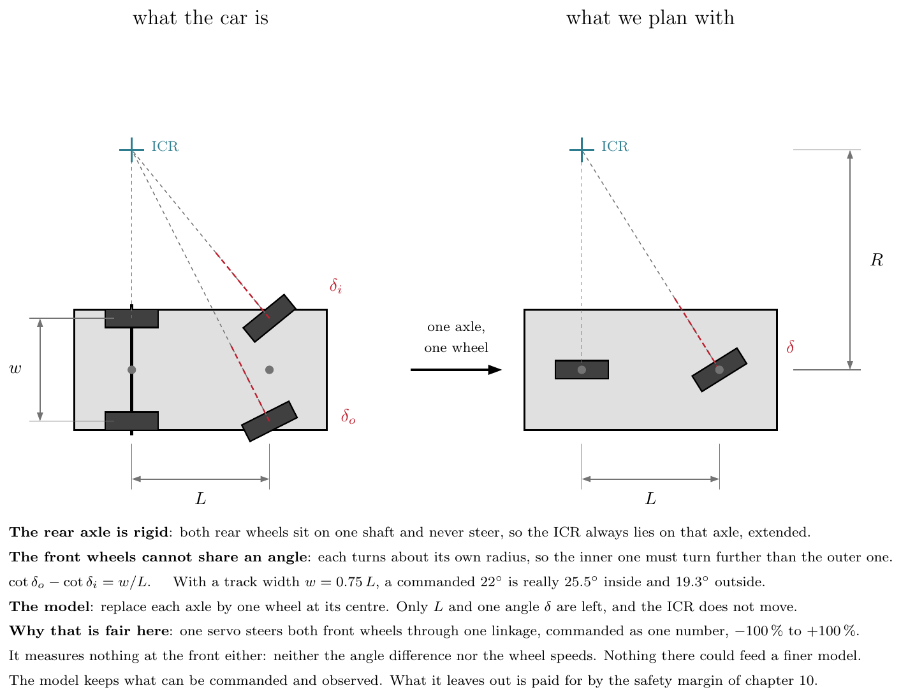

[THE GUIDED ROUTE](CORE_ROUTE.md) · [08 The vehicle](08_vehicle_neighbors.md) · [09 Practice circuit](09_practice_circuit.md) · [10 The CrazyCar track](10_crazycar_track.md)

# Appendix — going further

None of this is required. Chapters 08 to 10 work without a single line of it.

It is here because each section answers a question that a good student asks out
loud, and because the material is already built: the experiments exist, the
numbers are measured.

---

## Table of Contents

- [Appendix — going further](#appendix--going-further)
  - [A1 Four wheels, and the model that replaces them](#a1-four-wheels-and-the-model-that-replaces-them)
  - [A2 The servo does not get there at once](#a2-the-servo-does-not-get-there-at-once)
  - [A3 The grip limit](#a3-the-grip-limit)
  - [A4 Why one move is 0.119 m](#a4-why-one-move-is-0119-m)
  - [A5 The lap that fails at zero margin](#a5-the-lap-that-fails-at-zero-margin)
  - [A6 Tuning the controller](#a6-tuning-the-controller)
  - [A7 Driving a chain of moves by hand](#a7-driving-a-chain-of-moves-by-hand)

---

## A1 Four wheels, and the model that replaces them

The car has four wheels; the model has two. That is a decision, and it can be
defended.



The rear axle is one rigid shaft: both rear wheels sit on it and never steer, so
the centre of rotation is always somewhere on that axle, extended. The two front
wheels each travel on their own radius, so the inner one has to turn further
than the outer one — the **Ackermann** condition:

$$
\cot\delta_o - \cot\delta_i \;=\; \frac{w}{L}
$$

With a track width $w = 0.75\,L$, a commanded 22° is really **25.5° inside and
19.3° outside** — 6.1° apart.

Two reasons the lab may ignore that difference:

**You cannot command it.** One servo drives both front wheels through one
linkage, and what you send is a single number from −100 % to +100 %.

**You cannot observe it.** This car measures nothing at the front, neither the
angle difference nor the wheel speeds. A model that represented the two wheels
separately could never be checked against anything.

So the model keeps what can be commanded and what can be observed: one
wheelbase, one steering angle. What it leaves out is paid for by the safety
margin of chapters 09 and 10.

---

## A2 The servo does not get there at once

`P.steerRate` is 110 °/s and one simulator step is 1/25 s, so the steering moves
at most **4.4° per step**. Full left to full right takes 0.40 s.

That matters for one thing only: the primitives in chapter 08 assume the
steering is *already* at its value when the move starts. It is not — reaching
full lock from zero takes 0.20 s, which is five steps of a thirteen-step move.

`cc_primitives_probe` measures the real thing by driving `cc_step` with the
steering held, and `check_car_primitives` compares your formula against it. They
agree to 0.10 mm, because the planner's arcs are short and the controller is
usually already near the angle it wants.

---

## A3 The grip limit

`P.ayMax = 7.85 m/s²` is how much sideways acceleration the tyres hold.
Cornering at speed $v$ on a bend of radius $R$ needs $v^2/R$, so

$$
v \le \sqrt{a_{y,\max}\, R}
$$

The tightest bend of the oval route has $R = 0.296$ m, which allows
$\sqrt{7.85 \cdot 0.296} = 1.52$ m/s. `cc_speed_profile` applies that to every
point of the route, then smooths it so the car can brake into the bend and
accelerate out.

This is the whole reason the search may ignore speed: the **shape** of the route
is geometry, and the speed is a second pass over the finished shape.

---

## A4 Why one move is 0.119 m

The search stores a pose as a cell plus one of `P.nTheta = 16` headings, so one
heading step is $2\pi/16 = 0.3927$ rad.

At full lock the car turns 3.3002 rad per metre driven. To turn exactly one
stored heading it must drive

$$
s = \frac{0.3927}{3.3002} = 0.119\ \text{m}
$$

That is `P.arc`. It makes the tightest move land exactly on the next stored
heading instead of between two of them — which is why sixteen moves at full lock
close a circle to within 0.1 mm — see [A7](#a7-driving-a-chain-of-moves-by-hand).

A round 0.15 m would turn 28.4° per move, the headings would drift, and poses
that should be the same node would be stored as different ones.

---

## A5 The lap that fails at zero margin

In chapter 09 the sweep has one row that looks wrong: with `P.safety = 0` the
planner has **more** free space than in any other row, and it finds no lap at
all.

```matlab
for saf = [0.00 0.02 0.05]
    P = cc_params('Track','oval','safety',saf);
    CM = cc_car_model(cc_track(P), P);
    pose = P.start;
    fprintf('safety %.2f:', saf);
    goals = [P.checkpoints; P.start(1), P.start(2)];
    for k = 1:size(goals,1)
        lp = cc_search_car(CM, pose, goals(k,:), P.cpTol);
        if isempty(lp), fprintf('  leg %d FAILS\n', k); break, end
        pose = lp(end,:);
        fprintf('  CP%d at %+6.1f deg', k, mod(rad2deg(pose(3)),360));
    end
    fprintf('\n');
end
```

```
safety 0.00:  CP1 at  +56.0 deg  CP2 at +179.0 deg  CP3 at +212.0 deg  leg 4 FAILS
safety 0.02:  CP1 at  +56.0 deg  CP2 at +179.0 deg  CP3 at +222.9 deg  CP4 at +357.4 deg
safety 0.05:  CP1 at  +56.0 deg  CP2 at +179.5 deg  CP3 at +235.5 deg  CP4 at +348.0 deg
```

A checkpoint fixes a **place**, not a pose: the search stops as soon as it is
close enough, whichever way the car points. The next leg then has to start from
exactly that heading.

With no margin the first three legs take a tighter line and the car arrives at
CP3 pointing **212°** instead of 222.9°. From there, with five forward arcs and
no reverse gear, nothing gets back to the start inside the corridor.

This is what makes a pose search different from everything in chapters 02 to 06:
**the state you arrive in is part of the problem you leave for the next leg**,
and a route that is locally optimal can be globally impossible.

---

## A6 Tuning the controller

Chapters 09 and 10 judge a lap by two numbers, time and clearance. There is a
third, and this is the case that shows why.

```matlab
run('experiments/experiment_cc_tuning.m')
```

```
  LAP TIME         12.20 s        <- make this small
  CLEARANCE           19 mm       <- room in SPACE, keep it large
  GRIP RESERVE        65 %        <- room in GRIP, keep it low
```

The **grip reserve** is measured by driving the same route with the tyres made
progressively weaker — 95 %, 90 %, 85 % of `P.ayMax` — and reporting the lowest
value that still gets round. Low is good.

| | lap time | clearance | grip reserve |
|---|---|---|---|
| defaults | 12.20 s | 19.2 mm | 65 % |
| `ayPlan = 1.7` | **10.68 s** | 18.1 mm | **95 %** |

By lap time that setup is 1.5 s better and it never touches a wall. By the third
number it is one you would not put on a car: it plans corner speeds for a
vehicle with 70 % more grip than this one, and fails the moment the real car is
10 % worse than its model. A real car always is.

`tools/cc_tuning_defaults.m` holds eight values you may change, and
`experiments/experiment_cc_tuning.m` is the bench. Two results are worth the
detour:

- **`LdMax` does nothing above 0.28 m.** The lookahead is
  $L_d = L_{d0} + k \cdot v$, and with a top speed of 2.02 m/s it never exceeds
  0.32 m, so a cap above that is a cap on nothing.
- **`Ld0` makes the two safety numbers disagree.** A short lookahead gives more
  room in space (29.7 mm) and far less in grip (90 %); a long one is the other
  way round (11.0 mm, 70 %). The short lookahead corners harder: it spends seven
  steps at the grip limit against one.

Two targets, if you want something to aim at. Both must also get round the
practice oval with the same values — a setup that only works on the track it was
tuned on is a fitted curve, not a controller.

```
Target S, the lap you would put on hardware      Target F, the fast lap
  clearance  >= 35 mm                              lap time   <= 11.00 s
  reserve    <= 70 %                               clearance  >= 25 mm
  lap time   <  11.60 s                            reserve    <= 70 %
```

---

## A7 Driving a chain of moves by hand

Chapter 08 produces the fan from one pose. Chaining the moves instead — using
the end of one as the start of the next — shows what the search space looks like
from further away.

```matlab
P  = cc_params();
CM = cc_car_model(cc_track(P), P);
k  = find(P.steerLevels == 1);      % +100 %, held
pr = CM.prim(k);

pose  = [0 0 0];
track = zeros(17,3);  track(1,:) = pose;

for n = 1:16
    th = pose(3);
    pose = [pose(1) + pr.dx*cos(th) - pr.dy*sin(th), ...
            pose(2) + pr.dx*sin(th) + pr.dy*cos(th), ...
            pose(3) + pr.dth];
    track(n+1,:) = pose;
end

figure; plot(track(:,1), track(:,2), '-o'); axis equal; grid on
```

A **circle**, and it closes: sixteen moves at full lock come back to the start
to within **0.1 mm** and **0.02°**. One move turns 22.5°, and
$16 \times 22.5° = 360°$ — which is what `P.arc = 0.119 m` was chosen for
([A4](#a4-why-one-move-is-0119-m)).

For a steered chain, replace the fixed `pr` with a list of commands:

```matlab
drive = [100 100 50 0 -50 -100 -100 0 100 100];   % per cent, one per move
...
    k  = find(P.steerLevels*100 == drive(n));     % which of my options is that?
    pr = CM.prim(k);
```

Three questions worth answering with it:

- **Can you come back to where you started?** Yes — 16 × +100, for instance.
- **Can you make the car stand still?** No. Every move drives 0.119 m.
- **Can you turn on the spot?** No. Every turn costs 11.9 cm of driving, and
  there is no reverse gear.

That is the search space, seen from outside: every route the planner can ever
return is a chain of these moves, and nothing else is available to it.
